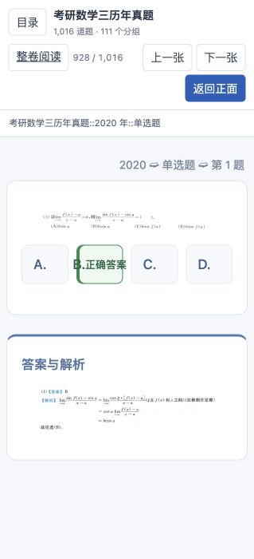

# 数学三原页步骤详解接入

本机交付日期：2026-11-02。未发布远端 Release。

## 范围

1987—2023 年，37 年共 1,016 道题；说明卡 1 张，总计 1,017 张卡。年份／题型子牌组 111 个，另有 `00 使用说明`。单选 294、填空 240、解答 467、判断 15。

1987—2019 采用用户指定的第二批步骤解析 PDF；2020—2023 采用随后指定的四份解析。原 PDF 未修改。详解步骤使用原页裁片保留公式，不由 OCR 重写数学表达式。OCR 仅辅助定位题号及边界。

新增详解对应 904 道题：1987—2019 的 815 道及 2020—2023 的全部 89 道。112 道早期试卷 V 题未从试卷 IV 资料中强行匹配，保留原有答案和引用。1993 年试卷 IV 选择第 4 小题、2002 年选择第 2 小题保留资料差异说明。

2020—2023 为去广告的原页公式阅读及逐题裁片，不是重新转写的 LaTeX。三个源入口均已接入；原版保留卷面，重排入口按题阅读，整卷练习按题展开答案。去除的广告区域通过 PDF 图片对象及摘要定位，未删除末题步骤。

## 生成与身份

`exam-library` 的 SQLite 只读来源 → `study_exam_source` → 通用来源包 → `study_exam_refresh` 单书事务刷新 → PostgreSQL 统一投影 → Web／APKG。

`scripts/deliver_math3_details.py` 只刷新 `math3-exams`，执行前保留单书备份；事务内比较旧卡身份、牌组位置、原生调度载荷、学习表及其他书记录。只同步该书的共同模板注册，未运行旧的额外 units 安装脚本。

源库 SHA-256：`aa299d44fa16bd6179e6bdc6b6c0c8f5a07a1448efae6a56133f9a64f39b9233`。

最终 APKG：`Math3-Past-Exams-Full-20261102.apkg`，190,555,124 字节，SHA-256：`bda53730a160da52dc687a15e4e58f1dcbce41513ed6581f85726c4e4c15460e`。

## 核验

- 源库 351 份文档，数学三 74 份；SQLite 完整性及外键检查通过。
- 38 份 PDF 摘要、480 处近期图片来源引用及早年详解图片摘要核验通过；目录列出的三个版本无缺链／缺图。
- 927 张原题的 note/GUID/native-card 身份保持，新增 89 题；其他书及学习表摘要不变。
- 官方 Anki 引擎在临时独立集合导入新版、重复导入两次、关闭重开检查通过。1,017 张卡的 6,098 个字段值逐字一致，1,145 个媒体文件 SHA 完全一致，无缺失媒体。
- 旧 928 卡完整包升级到新 1,017 卡包并重复导入通过；原身份、调度、暂停、旗标和复习日志保持。未操作用户个人 Anki 资料档案。
- 浏览器实际核对原页题面、整卷答案、重排解析及统一学习页“查看答案”翻面；截图见下。

定位、来源、答案字母和媒体核验不等于逐题重新证明全部数学结论。未声称 AnkiMobile／iPad 实机验收。

## 本机入口

- [真题库数学三](http://127.0.0.1:8765/exam-library/math3/index.htm)
- [学习书架](http://127.0.0.1:8771/)
- [数学三逐题学习](http://127.0.0.1:8771/math3-details-delivery-20261102/web/index.html)
- [下载完整包](http://127.0.0.1:8771/math3-details-delivery-20261102/Math3-Past-Exams-Full-20261102.apkg)

同局域网设备将 `127.0.0.1` 换为当前服务地址 `192.168.3.5`。
