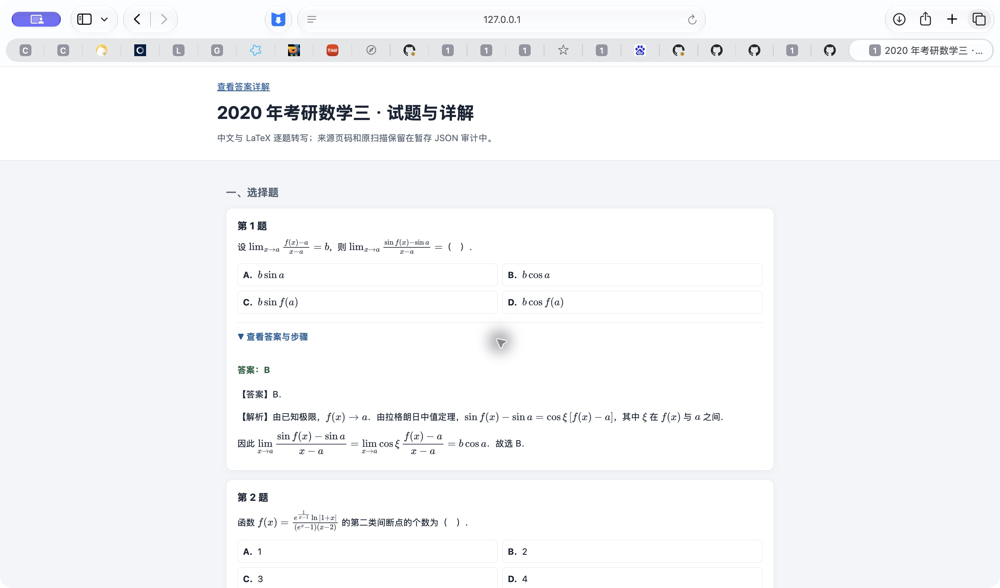
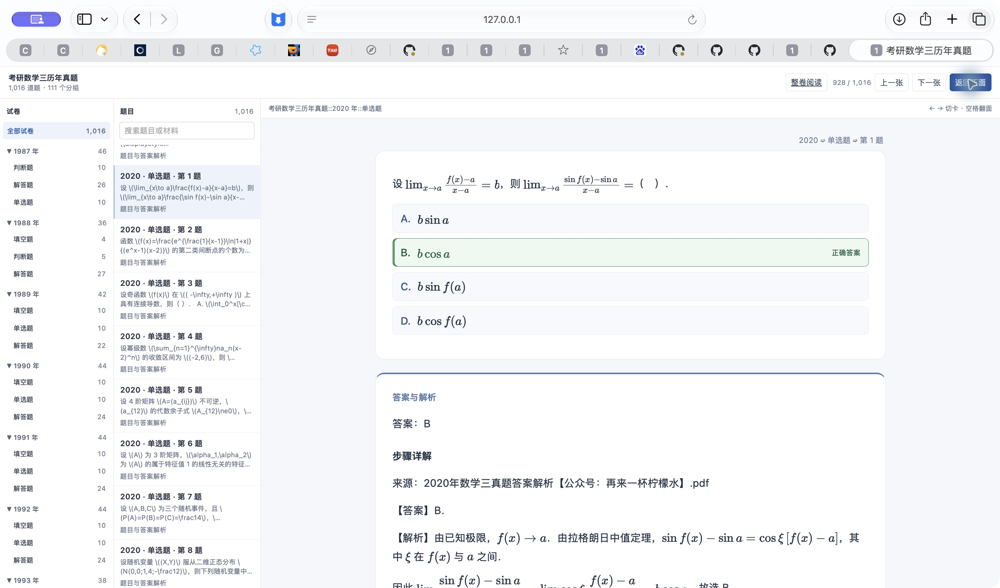

# 数学三文字与 LaTeX 步骤详解

本机更新日期：2026-11-02。尚未发布远端 Release。

## 交付范围

1987—2023 年，共 1,016 道题；另含 `00 使用说明` 卡 1 张，共 1,017 张。111 个年份／题型子牌组，另加 1 个说明子牌组。

904 道指定 PDF 详解已逐题转为中文与 LaTeX；2020—2023 年全部 89 道题的题干、选项及详解均为文字与公式。必要的独立几何图保留，整块扫描详解不参与展示。原 PDF、原扫描来源与定位信息保留。卡片正文不显示 PDF 来源文件名。

112 道早期试卷 V 题没有从指定试卷 IV 解析中唯一匹配，保留原答案与引用，未编造解答。原稿疑点和已确认的印刷笔误记录在逐题验证信息中；部分原稿冲突仍附来源提示。定位与公式编译通过不表示逐题重新证明了全部数学结论。

## 统一生成与检查

真题库 SQLite 来源 → 共同 `study_exam_source` 投影 → PostgreSQL 单书更新 → Web 与 APKG。原版入口保留原卷，重排和整卷逐题入口使用文字与 LaTeX 详解。近期 prepared 数据和后续重建接线也同步，避免下次重建退回扫描。

- 37 份年度转写源文件有 SHA256 固定记录；6,352 个不同公式经 MathJax 实际编译，无错误。
- 904 个详解面板全量检查，旧整块扫描已替换，重复生成不会追加第二份；近期题面无扫描图。
- 来源数据库完整性、外键及全部题目 ID、题型、题号一致性检查通过；其他学科字节保持。
- 单书更新保留原有 1,016 张题卡身份和原生卡载荷，学习表和其他书摘要不变。
- 官方 Anki 引擎完成旧包升级、两次重复导入、三次集合检查；1,017 张卡、6,098 个字段逐字一致，1,151 个媒体 SHA 一致，无缺失。实际用户资料档案未改。
- Safari 实际核对展开步骤和最终 Web 翻面，公式已渲染。未声称手机／iPad Anki 实机验收。

## 下载与入口

- [原书架](http://127.0.0.1:8771/)
- [真题库数学三](http://127.0.0.1:8765/exam-library/math3/index.htm)
- [逐题 Web](http://127.0.0.1:8771/math3-clean-display-20261102/web/index.html)
- [完整 Anki 包](http://127.0.0.1:8771/math3-clean-display-20261102/Math3-Past-Exams-Full-20261102.apkg)

同局域网设备将 `127.0.0.1` 换为 `192.168.3.5`。

完整包 192,407,319 字节，SHA256：`6189c9cf3c01a84bc93aa795a9eddc8d24d6f44078dae80725072e8d8e95506a`。约 5 MB 的通用来源包不是最终完整包；完整更新包保留旧媒体以维持既有资源完整性。

