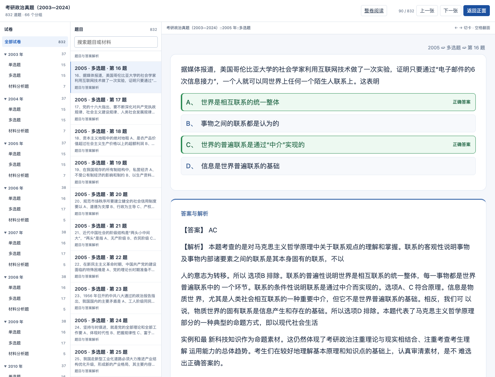

# 政治题库答案同步：Web 与 Anki

2026-11-01 本地交付。仍使用书籍身份 `politics-exams-2003-2023`，显示范围扩展至 2003—2024；没有新建替代书或另一套输出模板。

- [原书架](http://127.0.0.1:8771/)
- [原逐题入口](http://127.0.0.1:8771/politics-dual-20261031/web/index.html)
- [整卷阅读](http://127.0.0.1:8771/politics-dual-20261031/web/papers/index.html)
- [完整 Anki 包](http://127.0.0.1:8771/politics-answers-sync-20261101/Politics-2003-2024-Complete-20261101.apkg)

手机同局域网访问时将 `127.0.0.1` 换成 `192.168.3.5`。本次未发布远端，也未操作用户个人 Anki 集合。

## 内容和统一生成

原 794 道题的题面、标题和来源文字字段均未改写；只更新原来缺答案的 225 道题的 Answer、Status、SourceRecord。新增 2024 年 38 道题，共 832 题、22 套整卷、66 个有题题型子牌组，全部有明确映射答案。年份排序保持原样。

源卷库已从用户提供的 2003—2008 和 2024 答案 PDF 建立来源；本轮只读其 SQLite，不再解析、改写或删除原始 PDF。2024 选择题按来源答案表只展示当前题的字母答案，明确说明来源未附逐题解析；完整原表保留在 SourceRecord。主观题的“非官方答案，仅供参考”原文提示保留。没有编造解析或把整张答案表当作某一道题的独立分析。

`study_exam_source.read_bank` → 通用来源包 → `study_exam_refresh.refresh` → 原 PostgreSQL 书籍 → 同一 `project_book/project_note` → 公共 `export_book` 的 APKG/Web。原卷阅读库的三个版本和 8771 逐题书架是不同入口；本次补上的是后者和 Anki。原来的移动端原生翻面、点选／取消、下一题清空选择、背面选项判色、字号和隐藏章节规则均保留。

更新通过一个作用域事务完成，校验原 source ID、GUID 与题目键；旧 794 个笔记／卡片 ID 和模型保留。只追加新题；旧来源集合与不可变对象保留，新当前来源使用公共导出器已有的 skeleton 支持。字段修订写审计和原生修改版本，目录覆盖扩展至全部 832 张。其它书籍、模板登记和网页进度表摘要前后相同。

## 验收

- 独立审查与 10 项针对性测试通过：真实隔离 PostgreSQL 更新／导出、旧身份和调度载荷、其他书、模板、目录 ID 保留、事务回滚、过期来源／删题拒绝、按题答案表及来源提示。
- 全量浏览器交互检查覆盖 832 题、716 道选择题、2,894 个选项；保留原生手机桥接、选项增删／判色、正文题号隐藏、连续选择生命周期及 29 处知识还原隐藏。
- 官方 Anki 引擎隔离导入 832 张，重复导入两次，4,992 个字段逐字节相同，7 张媒体 SHA 相同，无缺失引用。
- 从旧 794 张包更新至新 832 张包，旧笔记／卡片身份、调度、标记、停学和复习日志保留；新增 38 张，重复导入不重复新增。重新打开隔离集合核对通过。
- 原 LAN 地址实际浏览通过：832 题、66 分组、22 整卷，2005 第 16 题 AC 和来源解析，2024 新题／主观参考提示，桌面与 390px 手机尺寸无横向溢出，脚本错误为 0。
- 手机 AnkiMobile 新完整包尚未进行本轮实机验收。浏览器触摸模拟和原生引擎验证不替代手机验收。

[机器核验摘要](evidence/politics-answers-sync-20261101.json)

## 已有牌组导入注意

先备份，再直接导入新包；不要删除旧牌组。旧身份保持，原生测试证明更新可保留学习记录。

**Anki 会保留客户端既有停学状态。**以前因缺答案默认暂停的题，导入后在“浏览”中用 `tag:answer::missing is:suspended` 找到，再核对属于本政治牌组并执行“取消暂停”。该标签是旧来源保留的历史标签，不代表新答案仍缺失；不要把自己手动暂停、希望继续停学的题一并恢复。新装新包所有题均有答案，不再默认停学。

旧卡所在牌组也是 Anki 客户端保留的状态；本包为新卡提供年份／题型子牌组，已有自定义位置不强制搬动。以前已经整理过的题型目录 ID 保持不变。

## 恢复与保留

更新前作用域备份位于私有 `backups/politics-answers-sync-20261101/`，包含旧书映射、字段组件指针、目录、原生载荷及元数据。原始 source、collection 和内容对象保留，可按备份和当前 source CAS 做本书前向回退；不整库覆盖学习状态。

原 Web 目录保留为本次单份 rollback 目录 `output/politics-answers-sync-20261101/previous-web`；书架原文有备份。新包下载使用新文件名，旧完整包未覆盖。生成目录没有复制英语词书资源。架构图、SVG/PNG 和 README 已同步检查更新。
