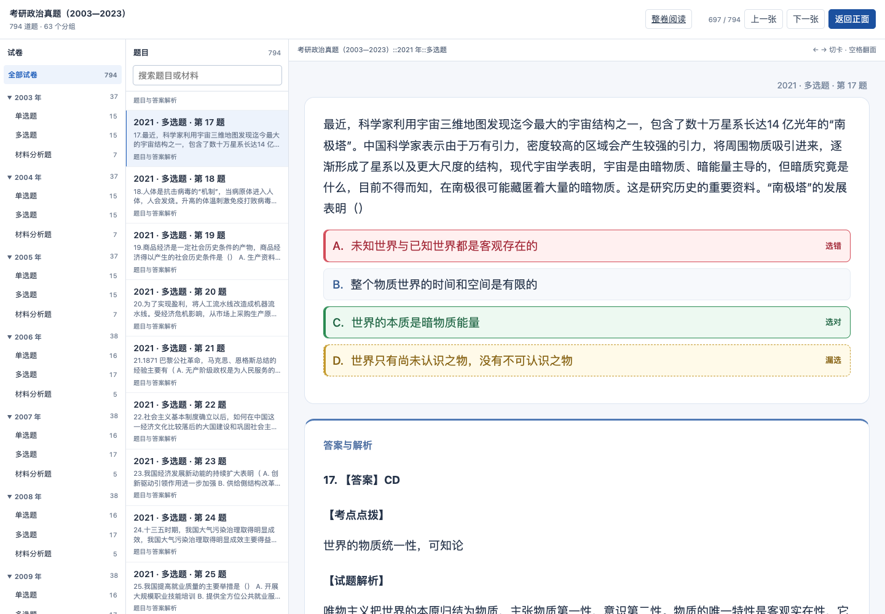
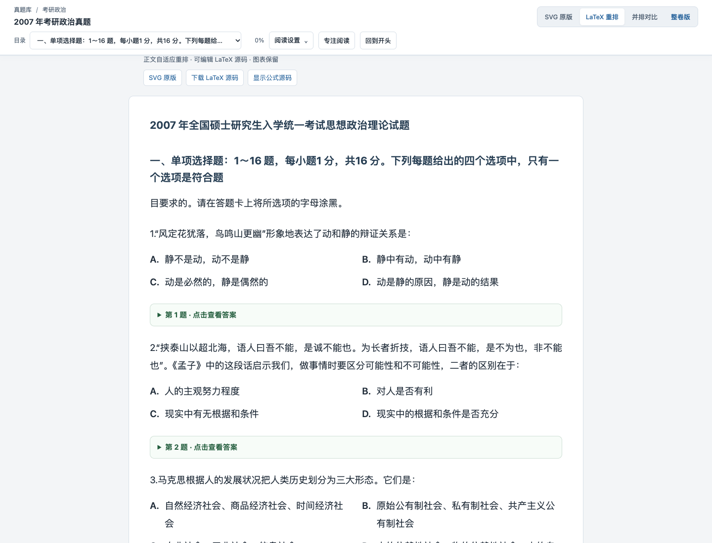

# 考研政治整卷与逐题卡片：本地交付记录

2026-10-31，源码分支 `feat/unified-study-database-20261015`。已完成本地交付，尚未推送、创建 PR 或发布远端 Release。

## 使用

- [原书架](http://127.0.0.1:8771/)已增加“考研政治真题（2003—2023）”，保持原三本英语词书入口。
- [整卷阅读](http://127.0.0.1:8771/politics-dual-20261031/web/papers/index.html)：按年份看完整试卷，逐题展开答案。
- [逐题浏览与翻面](http://127.0.0.1:8771/politics-dual-20261031/web/index.html)：按年份筛选，搜索题目和完整材料；搜索不索引背面答案。
- [完整 APKG 下载](http://127.0.0.1:8771/politics-answer-colors-20261101/Politics-2003-2023-Answer-Colors-20261101.apkg)：2,673,327 字节，约 2.7 MB。手机在同一局域网时，把网址中的 `127.0.0.1` 换成当前电脑地址 `192.168.3.5`。

每道父题一张卡：正面保留题目、完整材料、全部小问和选项，背面在完整正面下方接答案解析；题目路径显示在右上角，不再重复大标题或“回看”折叠。按年份保留 21 个父牌组，每年再分单选题／多选题／材料分析题，共 63 个有题子牌组，材料题不会把小问拆散。

**共 794 道题。现有源库中只有 569 道映射了答案；2003—2008 年的 225 道缺少答案，包内明确标记并默认停学，仍可在浏览中查看。没有补写或猜测答案。**因此“完整包”指已收录源题全部保留，不代表这 225 道已有解析。

网页当前提供浏览、翻面和整卷阅读；政治书未登记为网页 FSRS 评分牌组。Anki 正常管理自己的复习记录；不宣称两端学习进度同步。

## 背面选项标色与分页续接

翻面后按已保存的明确答案标记：选错为红色并标“选错”，选对为绿色，漏选正确项为黄色虚线；没有作答时显示正确项。正面不提前显示答案或结果，返回正面时恢复普通选中样式。整卷页只在对应题的答案展开后标色，收起后清除标色。缺少明确答案、答案字母不合法／重复／不属于实际选项时不判色；材料题不做字母选项判分。

标色只用于对照当前来源答案，不写入网页评分、Anki 调度或学习记录。原始题目、答案、审核记录和 63 个题型子牌组没有改变。

2007 年第 34 题“文”与下一页“章”的断段已修复：仅当相邻源页、同题来源映射、相邻汉字段落与未完词证据一致时移动 DOM 内容，不删除原文字，也不合并小问或真正的段落。卡片两端及 [8765 原卷库重排页](http://localhost:8765/politics-latex-2003-2023/papers/2007-questions.htm)均验证；原始 PDF／SVG、数据库和 SourceRecord 保留。

原卷库修复独立提交到 `exam-library` 的 `main`：`da92eb9`，遵循其 AGENTS.md 的普通修复直接推送约定；Anki 分支本次未推送。原卷库当前工作区的其他既有修改未带入提交。处理了原生答案面板预先插入导致的页内索引偏移，并将回归测试接入该库 npm test；已证明旧索引版本在此用例失败，新版本通过。

[本次验收证据](evidence/politics-answer-colors-20261101.json)。官方 Anki 引擎仍核对 794 张卡、4,764 个原始字段与 5 张媒体、两次重复导入和学习状态保留；手机 AnkiMobile 实机交互未作本轮验收。

## 2026-11-01 字体与题型子牌组

题干、选项、解析使用同一正文体系：桌面 19px、行高 1.8；手机尺寸 17px。选项字母由 700 降至 500 字重，缩小选项框留白，不把选项当作大标题。

目录为 `考研政治真题 → 年份 → 单选题／多选题／材料分析题`，21 个年份、63 个有题子牌组，共 794 张卡（单选 333、多选 350、材料分析 111）。整卷阅读仍为 21 套，未按题型拆碎整卷。

### 已装旧包时怎么更新

**Anki 的 APKG 更新会保留既有卡片所在牌组。**仅导入新包不会自动搬动已存在的旧卡，这是原生测试观察到的行为；新装的 794 张会直接进入 63 个子牌组。

1. 先[导入新版 APKG](http://127.0.0.1:8771/politics-answer-colors-20261101/Politics-2003-2023-Answer-Colors-20261101.apkg)。
2. 已装旧包的用户，再下载[一次性整理工具（电脑版 Anki）](http://127.0.0.1:8771/politics-type-groups-20261101/Politics-By-Type-Organizer.ankiaddon)，在“工具 → 插件 → 从文件安装”中安装并重启 Anki。
3. 点击“工具 → 整理政治真题：年份 → 题型”，核对数量后确认；完成后正常同步到手机。新装用户无需此工具。

整理工具只匹配既定 GUID，且只移动仍在指定原年份牌组的卡；自定义位置、筛选牌组、未找到或身份不唯一的卡不动。目标子牌组必须已由新包导入。它不会自动操作个人集合，必须手动点击、确认才执行；本次没有打开或修改用户个人 Anki 数据。

隔离原生集合已验证：包括已复习卡在内的 794 张移动后，除牌组／修改版本外的卡片状态、笔记 ID／GUID／字段和复习日志均保持一致；立即一次撤销可恢复全部原位置，重复运行不重复移动。之后新的客户端操作可能使撤销不可用，遵循 Anki 自身规则。实际插件菜单和手机仍待实机验证。

共享总库用 `book.units.v1` 记录目录覆盖，不改原始 source collection 或 native card payload。公共 Web/APKG 投影消费同一份映射；带有旧来源目录的书也会以当前映射为准。新增泛用整理器由 `scripts/build_native_unit_organizer.py` 打包，不按书籍重复实现。

[本次完整核验](evidence/politics-type-groups-20261101.json)。本机作用域备份在 `backups/politics-type-groups-20261101/before.json`；需要回退时仅在匹配当前修订的事务中撤销这本书的 unit overlay 并提交 CSS 反向修订，保持原始来源和其他书不动。个人卡片的回退使用 Anki 的一次撤销。

## 2026-11-01 交互修复

单选只能选一个，多选可增删选项；已选项再次点击即可取消。支持键盘及触摸，翻面保留当前选择。“已选／清除选择”整栏已删除。题面与原始答案字段均未改写。2005 年挤在同一段的选项只有在完整文本与源选项精确一致时才转换为点选行。

背面通过同一模板的 `{{FrontSide}}` 保留完整题面，在下方接答案卡片。去掉“真题练习”和重复的大标题；年份、题型、题号在右上角显示。正文开头的题号仅在显示 DOM 中去掉，原始字段与小问编号保留。题面新增“查看答案”按钮，网页仅由该按钮或顶部“显示答案”翻面；点击选项、正文和空白不翻面。

全量检查覆盖 794 题、683 道选择题、2,762 个选项。原网址实际加载路径下验证了 2003、2005、2023 的单选、多选以及翻面布局；Anki 官方引擎从旧包更新、再次导入两次、字段和媒体核对通过，手机 AnkiMobile 实机仍待验证。[本轮最终证据](evidence/politics-explicit-answer-20261101.json)。

### 原生客户端点击边界

按 [AnkiMobile 官方说明](https://docs.ankimobile.net/more.html)为当前题面、选项和空白容器标记 `tappable`，避免将交互当作原生点按手势。页面复用后离开题目 DOM 时，会恢复原 body/html 类名、样式，卸载监听和 observer；回归检查已验证后续其他词书不继承这一保护。

网页按钮调用现有公共翻面宿主；Anki Desktop 使用暴露的 `pycmd('ans')`，暴露 `showAnswer()` 的客户端走相应接口。**没有模拟可配置的 iOS 中区点按，也不会在正面偷显示答案来伪造原生翻面或调度。**没有暴露可用命令时，内嵌按钮明确提示使用客户端“显示答案”按钮。AnkiMobile 原生手势和按钮仍待手机实机验证，不能将浏览器触摸模拟或官方引擎导入核对说成手机验收。

## 统一生成与来源

`study_exam_source.read_bank` 只读题库，`study_exam_package.source_package` 将题库适配为不可变输入包。输入经现有导入器进入 PostgreSQL `study_catalog`，再由相同 `project_book/project_note`、`study_catalog_export._apkg/_web` 生成双端。整卷页消费同一投影和模板，未另写一套政治题目或答案解析器。

题目与原始答案块逐条对照：794 道父题、2,762 个选项、213 个小问、569 份答案文本及 5 张 SVG 均保留。答案使用映射到的原始来源块，避免只读规范化 explanation 时遗漏作答要点。2003 年第 6 题的公式已在浏览器离线渲染。

源库 SHA256：`49f96955e79089f76f9aa983ad795cad90a8503fac57b1b1fc6d3a1e606460c3`，构建后未变。两个 iCloud 未下载 SVG 使用其精确 Git 索引对象恢复至本次独立缓存，校验源文件大小、mtime、Git blob 身份及缓存 SHA；没有改写原文件。

稳定书籍 ID 为 `politics-exams-2003-2023`，GUID 由通用题目命名空间、书籍 ID 和源题 ID 生成。以后更新必须沿用这些身份。六个字段为 Title、Question、Answer、Source、Status、SourceRecord；正文全部内嵌，无十条例句限制或延迟片段依赖。

## 验收与边界

- 49 项针对性自动检查通过，覆盖来源、字段、身份、默认停学、媒体路径、完整材料搜索、答案不泄露和旧书架兼容。
- Anki 26.9.3 官方引擎在隔离集合导入 794 张卡；重复更新两次、重新打开三个检查点，身份、调度、停学、标记与模拟复习日志保留。4,764 个字段值逐字节一致，5 张媒体 SHA 一致。未操作用户个人 Anki 集合。
- 实际 Chromium 桌面及手机尺寸浏览通过：2023 年第 34 题材料与答案、2006 年第 38 题插图、2003 年第 6 题公式；21 个整卷入口，2023 卷 38 题；完整材料末尾可搜索，无横向溢出。
- 独立审查未发现重大问题。现有三书记录和对象描述未被覆盖，10 张网页学习进度表摘要前后相同。
- **尚未做手机 AnkiMobile 实机导入，浏览器尺寸模拟不代替实机验收；本次也未宣称 Safari 性能或秒开保证。**

[公开核验摘要](evidence/politics-dual-20261031.json)。本机详细报告位于 `output/politics-dual-20261031/`。

## 保留与回退

保留源题库、原始资源、总库中的不可变来源、`data/study-catalog/sources/politics-exams-2003-2023/source.apkg`、最终 APKG、当前 Web 及源审计。本次仅新增政治书；旧书和进度未迁移、删除或重建。

追加前的旧行摘要与元数据保存在私有 `backups/politics-dual-20261031/before.json`。书架原稿保存在同目录的 `bookshelf-before.html`。若需撤下本地入口，先恢复书架原稿；再在事务中仅撤销本次新增书籍的专属映射和分类登记，不删除共享对象、其他书籍或审计历史。不得用整库覆盖恢复影响现有学习记录。

## 10 月 31 日历史截图（交互布局以上方 11 月 1 日截图为准）

### 手机自定义翻面按钮：独立验证中（2026-11-01）

当前完整包中的按钮尚未通过 AnkiMobile 原生翻面验收，出现“请使用客户端的显示答案按钮”属于未完成项。独立两张合成测试卡仅验证原生点按桥接，不覆盖正式题库，不改总库或学习记录。测试前须确认 AnkiMobile 的正面中央点按动作是“显示答案”，再勾选测试卡内的确认框；未确认时不会调用点按桥接。

浏览器模拟已验证正确消息、选项再次点击取消、不隐式翻面，以及不调用内部答案 HTML 渲染器。这不等于手机验收。须在真实 AnkiMobile 正常复习中，点击自定义按钮后看到完整背面及原生评分按钮，才能推广至完整包。浏览预览需另外核实。证据：[手机翻面验证状态](evidence/politics-mobile-reveal-probe-20261101.json)。此阶段未改变正式生成架构，完整架构图无需调整。
