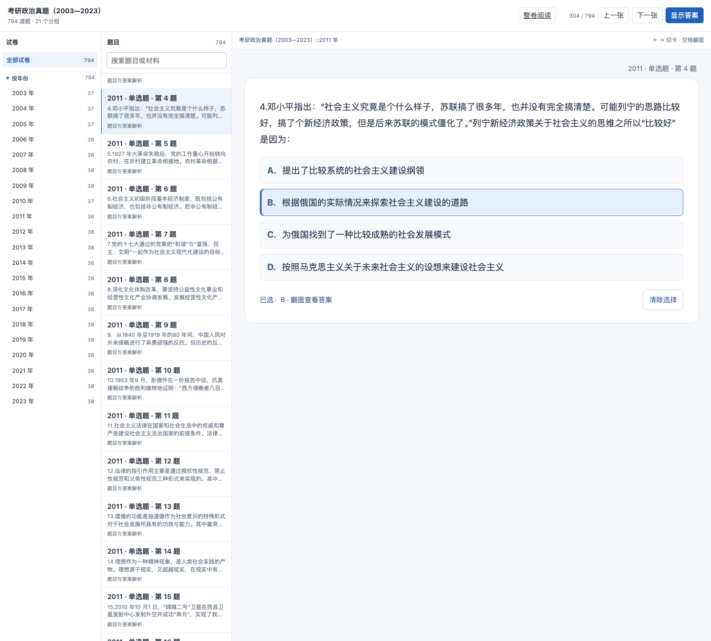
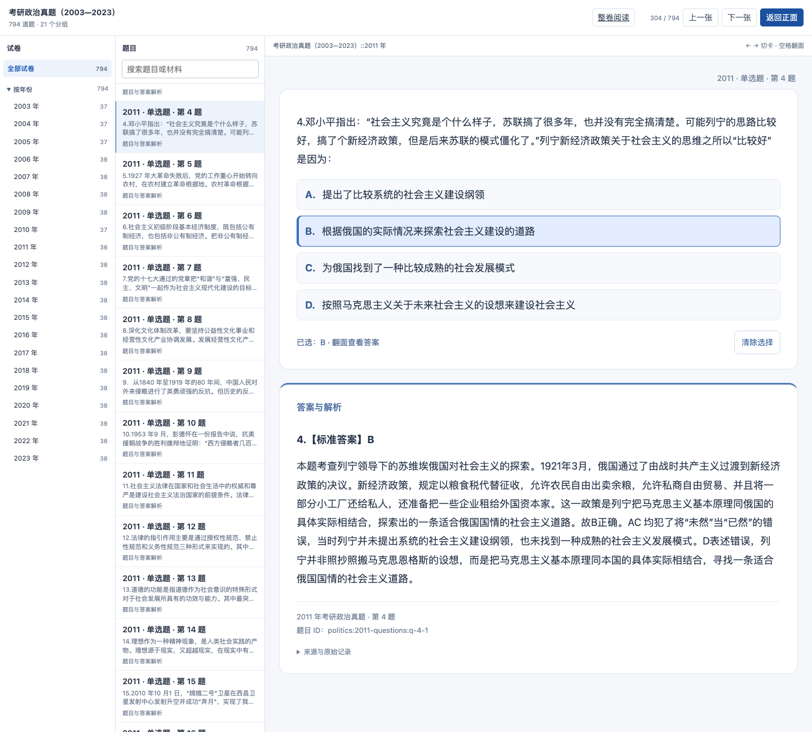
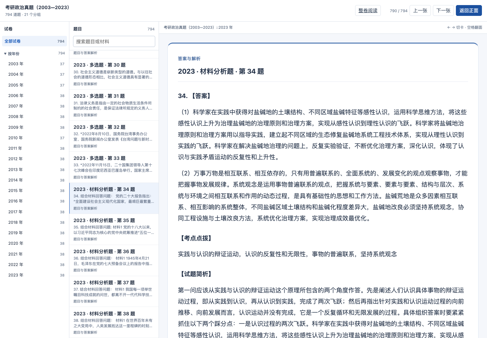
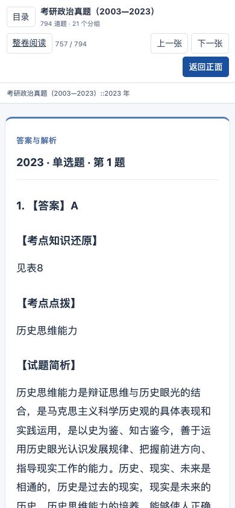
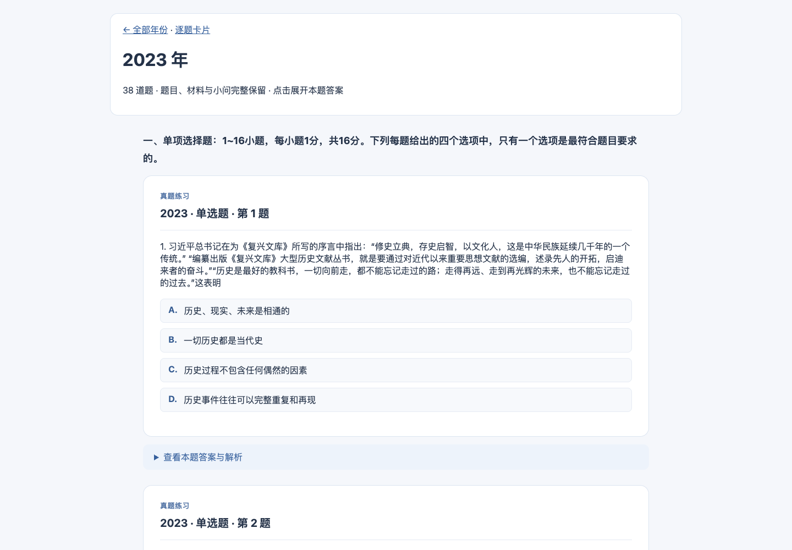

# 考研政治整卷与逐题卡片：本地交付记录

2026-10-31，源码分支 `feat/unified-study-database-20261015`。已完成本地交付，尚未推送、创建 PR 或发布远端 Release。

## 使用

- [原书架](http://127.0.0.1:8771/)已增加“考研政治真题（2003—2023）”，保持原三本英语词书入口。
- [整卷阅读](http://127.0.0.1:8771/politics-dual-20261031/web/papers/index.html)：按年份看完整试卷，逐题展开答案。
- [逐题浏览与翻面](http://127.0.0.1:8771/politics-dual-20261031/web/index.html)：按年份筛选，搜索题目和完整材料；搜索不索引背面答案。
- [完整 APKG 下载](http://127.0.0.1:8771/politics-selection-20261101/Politics-2003-2023-Interactive-Final-20261101.apkg)：2,664,018 字节，约 2.7 MB。手机在同一局域网时，把网址中的 `127.0.0.1` 换成当前电脑地址 `192.168.3.5`。

每道父题一张卡：正面保留题目、完整材料、全部小问和选项，背面在完整正面下方接答案解析；题目路径显示在右上角，不再重复大标题或“回看”折叠。按年份分为 21 个子牌组，材料题不会把小问拆散。

**共 794 道题。现有源库中只有 569 道映射了答案；2003—2008 年的 225 道缺少答案，包内明确标记并默认停学，仍可在浏览中查看。没有补写或猜测答案。**因此“完整包”指已收录源题全部保留，不代表这 225 道已有解析。

网页当前提供浏览、翻面和整卷阅读；政治书未登记为网页 FSRS 评分牌组。Anki 正常管理自己的复习记录；不宣称两端学习进度同步。

## 2026-11-01 交互修复

单选只能选一个，多选可增删选项，支持清除、键盘及触摸；翻面保留当前选择。题面与原始答案字段均未改写。2005 年挤在同一段的选项只有在完整文本与源选项精确一致时才转换为点选行。

背面通过同一模板的 `{{FrontSide}}` 保留完整题面，在下方接答案卡片。去掉“真题练习”和重复的大标题；年份、题型、题号在右上角显示。选项在背面改选、清除时只有一份实时状态，不残留旧选择提示。

全量检查覆盖 794 题、683 道选择题、2,762 个选项。原网址实际加载路径下验证了 2003、2005、2023 的单选、多选以及翻面布局；Anki 官方引擎从旧包更新、再次导入两次、字段和媒体核对通过，手机 AnkiMobile 实机仍待验证。[本轮证据](evidence/politics-selection-20261101.json)。

## 统一生成与来源

`study_exam_source.read_bank` 只读题库，`study_exam_package.source_package` 将题库适配为不可变输入包。输入经现有导入器进入 PostgreSQL `study_catalog`，再由相同 `project_book/project_note`、`study_catalog_export._apkg/_web` 生成双端。整卷页消费同一投影和模板，未另写一套政治题目或答案解析器。

题目与原始答案块逐条对照：794 道父题、2,762 个选项、213 个小问、569 份答案文本及 5 张 SVG 均保留。答案使用映射到的原始来源块，避免只读规范化 explanation 时遗漏作答要点。2003 年第 6 题的公式已在浏览器离线渲染。

源库 SHA256：`49f96955e79089f76f9aa983ad795cad90a8503fac57b1b1fc6d3a1e606460c3`，构建后未变。两个 iCloud 未下载 SVG 使用其精确 Git 索引对象恢复至本次独立缓存，校验源文件大小、mtime、Git blob 身份及缓存 SHA；没有改写原文件。

稳定书籍 ID 为 `politics-exams-2003-2023`，GUID 由通用题目命名空间、书籍 ID 和源题 ID 生成。以后更新必须沿用这些身份。六个字段为 Title、Question、Answer、Source、Status、SourceRecord；正文全部内嵌，无十条例句限制或延迟片段依赖。

## 验收与边界

- 49 项针对性自动检查通过，覆盖来源、字段、身份、默认停学、媒体路径、完整材料搜索、答案不泄露和旧书架兼容。
- Anki 26.9.3 官方引擎在隔离集合导入 794 张卡；重复更新两次、重新打开三个检查点，身份、调度、停学、标记与模拟复习日志保留。4,764 个字段值逐字节一致，5 张媒体 SHA 一致。未操作用户个人 Anki 集合。
- 实际 Chromium 桌面及手机尺寸浏览通过：2023 年第 34 题材料与答案、2006 年第 38 题插图、2003 年第 6 题公式；21 个整卷入口，2023 卷 38 题；完整材料末尾可搜索，无横向溢出。
- 独立审查未发现重大问题。现有三书记录和对象描述未被覆盖，10 张网页学习进度表摘要前后相同。
- **尚未做手机 AnkiMobile 实机导入，浏览器尺寸模拟不代替实机验收；本次也未宣称 Safari 性能或秒开保证。**

[公开核验摘要](evidence/politics-dual-20261031.json)。本机详细报告位于 `output/politics-dual-20261031/`。

## 保留与回退

保留源题库、原始资源、总库中的不可变来源、`data/study-catalog/sources/politics-exams-2003-2023/source.apkg`、最终 APKG、当前 Web 及源审计。本次仅新增政治书；旧书和进度未迁移、删除或重建。

追加前的旧行摘要与元数据保存在私有 `backups/politics-dual-20261031/before.json`。书架原稿保存在同目录的 `bookshelf-before.html`。若需撤下本地入口，先恢复书架原稿；再在事务中仅撤销本次新增书籍的专属映射和分类登记，不删除共享对象、其他书籍或审计历史。不得用整库覆盖恢复影响现有学习记录。

## 10 月 31 日历史截图（交互布局以上方 11 月 1 日截图为准）

