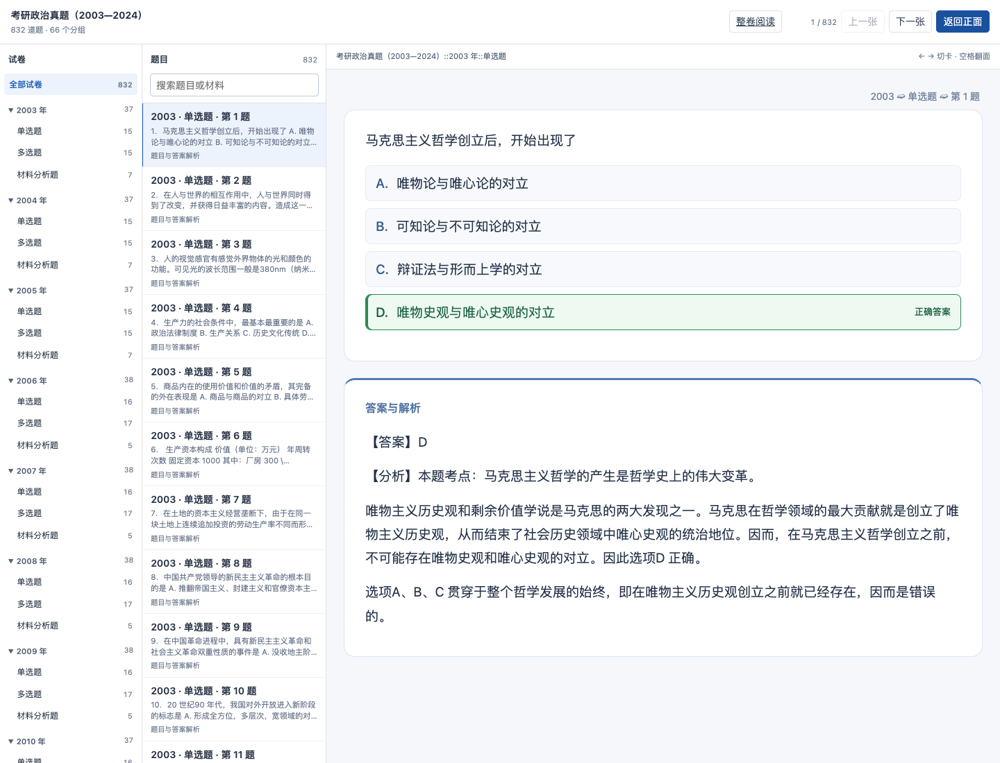

# 政治题文与解析的硬换行修复

2026-11-01，本地双端更新；题数仍为832、题型子牌组66、媒体7份。

[完整 Anki 包](https://github.com/CHNragdoll/anki-pipeline/releases/download/politics-exams/Politics-Past-Exams-With-00-Guide-20261102.apkg) · [固定发行页](https://github.com/CHNragdoll/anki-pipeline/releases/tag/politics-exams) · [原刷题入口](http://127.0.0.1:8771/politics-dual-20261031/web/index.html) · [8765政治阅读库](http://127.0.0.1:8765/exam-library/politics/index.htm)

## 修复和范围

早期PDF的印刷行距相同，但混合字体字框高度略有差异。原导入器按字框空隙判断新段落，把“马克思主／义”等普通续行误拆成新段。本次改为按重复基线行距、缩进、短行句末和题号／小问／答案标记判断；真实段落、材料、选项和小问仍保留。

全量扫描2003—2024政治题卷和解析，另修复2021、2023解析的5处明显词中断段。同段跨页也接成一个完整段落：新PDF转写依据行宽和缩进标注43处；旧源依据相邻源页、同一题号、明确未完续文标注48处。含多个真实内段的材料块只连接上一页末段与下一页首段，不合并整块材料。

共91处已确认跨页续段，在8765题文／解析重排页、整卷刷题页和公共Anki/Web卡片中实际合并显示。内部flow属性仅为来源依据，不是只标记不连接。原始PDF、SVG原版物理版面及文字保留；可编辑TeX的这些续段也去除了段间空行，不宣称重新编译了全部TeX PDF。

## 统一生成和验证

8765源库提供同一份明确续段映射，Anki与逐题Web继续使用同一PostgreSQL投影、同一题目模板和公共导出器。旧卡GUID、笔记／卡片身份和学习记录保留，不新建替代书。

- 832道题的题号、选项、完整材料和小问，以及全部答案字段的非空白字符核对一致；没有增删答案文字或更改答案键。
- 11项给定PDF解析测试及3项旧源端点／歧义回归通过；来源库完整npm测试通过。
- 8765原LAN入口实际检查22套题卷、22份解析，91个flow各只剩一个显示段落；整卷答案也验证续接，手机尺寸无横向溢出，脚本错误为0。
- 832题、716道选择题、2,894个选项的共享模板交互回归通过；翻面、选项增删、下一题清空、选错标红、真实分段和来源隐藏逻辑保留。
- 官方Anki引擎从上一份832卡完整包更新新包、重复导入两次及重新打开检查通过：旧身份／调度／停学／标记／复习日志保持，4,992个字段逐字节一致、7份媒体SHA一致、缺失0。
- 新完整包尚未进行本轮手机AnkiMobile实机验收；未操作用户个人集合。Anki代码和包本轮未发布远端。

[机器核验记录](evidence/politics-paragraph-flow-20261101.json)



本书事务前恢复引用保存在私有backups目录；8765仅合并本次来源和阅读器改动，保留其他299份卷库数据和既有本地reader改动。原书架与原Web入口不变，旧APKG文件不覆盖，更新请使用上述新包。已有停学状态由Anki保留，取消暂停的方法见[上次更新说明](POLITICS_ANSWERS_SYNC_20261101.md)。

## 顶层牌组名称更新

按用户要求，当前完整包顶层名称改为“考研政治历年真题”。年份和题型层级保留，832张卡的身份、字段、模板、学习记录及7份媒体字节不变；包内88个年份及题型牌组路径只替换根名称。未操作个人Anki集合，既有集合导入后是否自动改名未作客户端承诺。原完整包保留供恢复。结构没有变化，架构图无需调整。

## 独立使用说明卡（2026-11-02）

当前完整包新增1张说明卡，放在“考研政治历年真题::00 使用说明”子牌组；共833张卡，其中真题仍832道。说明包含题型层级、选项增删、查看答案、答案颜色、AnkiMobile点按配置及更新方式。原832张卡的全部数据库行、模板、牌组配置和7份媒体逐项核对不变；原包保留，不修改个人集合。本轮只新增说明卡，不改变系统架构。2026-11-02 已在官方 Anki 引擎的独立测试集合验收旧832题更新为833张、重复导入两次及完整833张包重复导入；原题身份、字段、调度、停学、标记、复习日志和媒体保持。电脑个人集合仅做只读牌组截图，未在本轮写入；手机新版仍未验收。

## 改名与说明卡的复现命令

政治正文仍通过 `study_catalog_export` 共享投影导出；以下两步是该完整包的明确交付后处理，不修改 PostgreSQL 总库或个人集合。每次从原始832题导出后，都必须运行两步，不能把中间原始包当作最新交付。新文件路径必须不存在，旧完整包保留。

```sh
python scripts/rename_apkg_root.py /path/to/exported-832.apkg /path/to/renamed-832.apkg '考研政治真题（2003—2024）' '考研政治历年真题'
python scripts/add_politics_guide.py /path/to/renamed-832.apkg /path/to/final-833.apkg
python -m unittest tests.test_politics_delivery_metadata -v
```

说明卡使用独立、固定的模型／笔记／卡片身份，原题数据库行与媒体逐项核对不变。后处理不增加题数，也不替代内容总库；再次对已含说明卡的包执行会拒绝，避免重复添加。

正式发行入口、文件摘要与发布步骤见[政治固定发行记录](RELEASE_POLITICS.md)。
