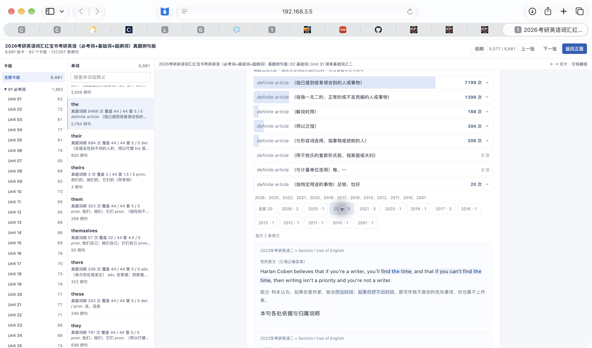
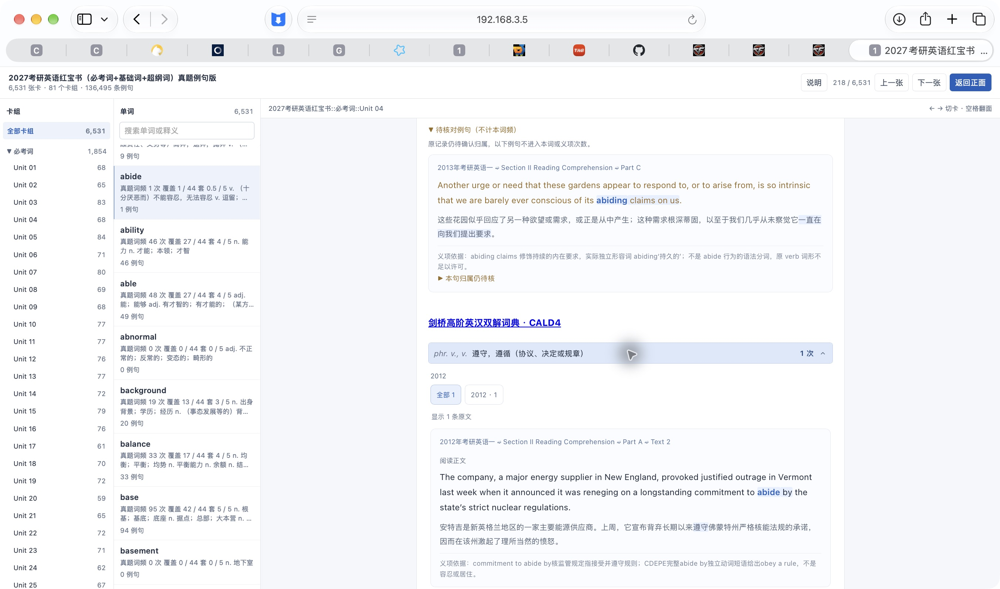
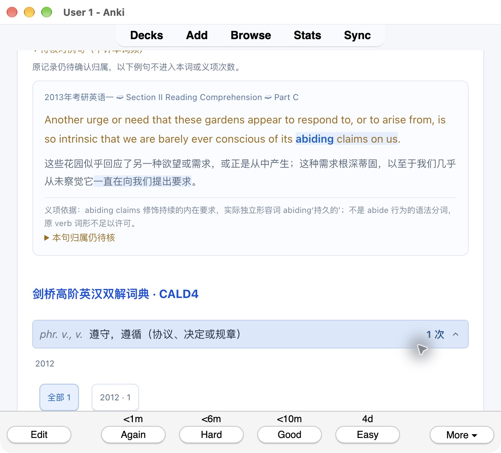
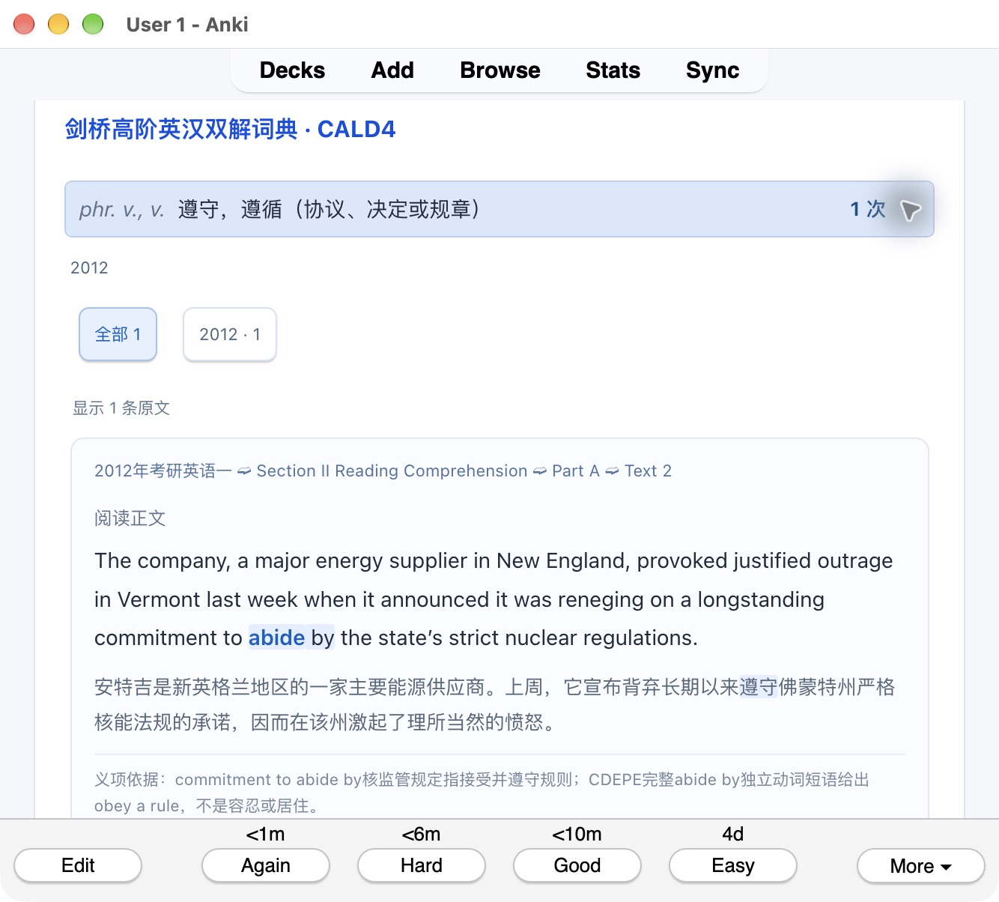
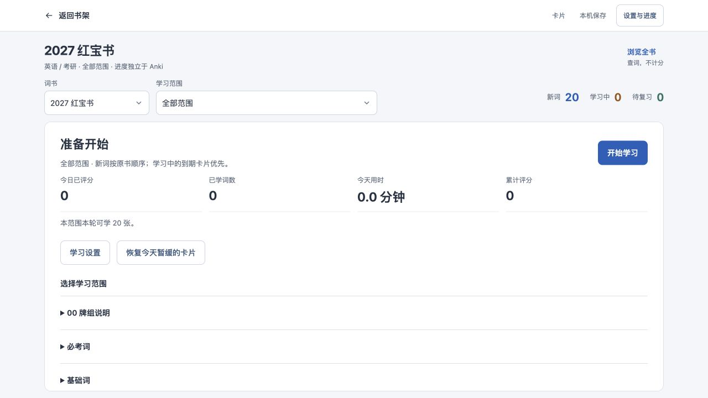

# 统一总库与原生候选：截至2026-10-18的过程记录

以下保留README原有的历次实现、失败、时点数字与图片引用。各段只适用于所述源码和范围；
[当前交付状态](../README.md#postgresql-统一总库当前开发分支)及各项封存报告优先。
其中“随后”“尚未”等措辞保留当时含义，不能作为最新全书或设备验收。

## PostgreSQL 统一总库（当前开发分支）

**指定内容和网页学习状态已统一到 PostgreSQL；三本完整网页已接回原书架，秒开速度和新 Anki 包仍分别验收。**
当前分支为 `feat/unified-study-database-20261015`。三本共 **15,174 条笔记**已全部生成，其中两本红宝书
**13,212 条词卡**采用共同完整渲染结果，2 张说明卡和 1,960 张刘晓艳词卡保留各自原内容能力；
三个入口使用同一份 HOST、FRAME 和 binder，目录仍为原来的卡组／单词／卡片三栏。

原入口保持：[2027 红宝书](http://localhost:8771/study-catalog-20261015/master-redbook2027-web-v3/index.html)、
[2026 红宝书](http://localhost:8771/study-catalog-20261015/master-redbook-web-v3/index.html)、
[2027 刘晓艳](http://localhost:8771/study-catalog-20261015/master-liuxiaoyan2027-web-v3/index.html)，
以及[原书架](http://localhost:8771/study-catalog-20261015/index.html)。

10 月 17 日采用用户已确认的完整渲染版本；此前 **4.464 秒**是一次历史最大卡实测，
不是本轮冷缓存或每次加载保证。全量接入时实测发现 2026 旧入口的加载脚本不认识新 envelope，
现已统一为经过验证的共同脚本；原 wrapper、prepared、正文、双语 chunk、审核记录和计数不变。
Safari 已核对 2026 最大 `the` 的 9,466 次／44 套、20 次同义合并为 19 条，
筛 2022 年 3 次合并为 2 条，以及重复翻面保留筛选；2027 最大卡的同类观察独立保留。
[全量接入、HTTP、实际观察和回退证据](../output/study-catalog-20261015/complete-web-full-v1/README.md)
明确区分页面表现、工具调用时间和原生验收，没有用工具耗时充当新的首开速度。

2027 正式入口的 `abide` 两处展开区也已核对：待核对的 2013 年原句与有 1 次词频的 2012 年原句，
完整双语内容、目标块和依据均显示，主例句按实际展示编号为 1。

网页和 Anki 继续复用[共同构建与内容寻址资源](STUDY_COMPLETE_SHARED_BUILD_20261017.md)。
[原文序号](STUDY_COMPILED_NUMBERING_20261017.md)、
[共同网页接线](STUDY_COMPILED_WEB_ATTACHMENT_20261017.md)、
[完整审核结构](STUDY_COMPILED_HISTORY_COVERAGE_20261017.md)、
[闭合审核无损共享](STUDY_CLOSED_AUDIT_COMPACTION_20261017.md)、
[归档年份筛选](STUDY_ARCHIVED_YEAR_FILTER_20261017.md)与
[原词组转归历史](STUDY_RESIDUAL_OWNER_HISTORY_20261017.md)的来源和验证记录分别保留。
`much`、`more`、两年 `go` 以及两年最大 `the` 的 HTML/profile 已齐全；未删除原始审核资料来减小派生产物。

10 月 18 日的两本 Anki **v3 完整候选包**均已生成：2026 为 **893.3 MB**，2027 为 **780.4 MB**。
保留原十字段结构，Meta 使用可逆的纯文本校验末尾，避免浏览编辑器删除脚本后报“完整卡片无法校验”。
两年 13,212 个原 Meta 的兼容条件已核对；两本完整包的最终归档、实际默认更新和重复导入均已通过，
原生客户端分别核对 66,813／65,313 个字段值与 89,445／87,769 份媒体，身份和测试学习状态保留。
真实“浏览→预览”、手机和首次翻面速度仍待验证，不能把代码修复当成客户端已通过。
[完整候选包与逐项结果](../output/study-catalog-20261015/complete-anki-redbooks-v3/README.md)随本轮检查更新。

后续实际运行检查发现 v3 原生提取遗漏了约 2 KB 的原作者年份筛选处理器，点击年份会触发校验失败；
同词的原网页版筛选正常。现已在正常 projector 恢复原代码，相关 43 项及独立复核通过；
完整原内容的小样中 `venture` 的 2021／2004／全部分别显示 1／2／4 条，总词频保持 4 次，
`abide` 两处原句和 2012 筛选也正常。包含此修复的 **v4 两本完整候选已重导出并通过归档核对**；
2026 的实际默认更新及重复导入通过，2027 的这一轮原生导入尚未运行。
**2026 手动进入 Browse／Preview 仍发生卡顿和崩溃，不能作为已完成修复交付。**
[修复来源、前后状态和截图](../output/study-catalog-20261015/native-year-filter-fix-20261018/README.md)。

进一步核对确认：空的 Browser 专用模板回退到普通加载模板，Anki 列表后端把 Meta 校验数据
转成约 **9.7 KB 的列表文字**，`abide` 词名因此未出现在 Question／Answer 单元格。
共同原生适配器现为缺省的 Browser 模板使用原排序字段，保留已有自定义模板；完整预览和刷卡模板不变。
隔离的 6,682 张完整卡测试库已放入同样的列表候选，`abide`／`venture` 正确显示，
所有笔记、卡片及复习记录逐行摘要相同，原编辑区设置也已恢复。
**后续手动复验仍卡死，这项列表修正没有解决完整界面故障。** 已停止自有隔离 Anki 进程，
保留卡死时数据库字段读取及界面等待锁的线程现场；具体原因仍在定位，完整包尚未重建。
[故障、共同修正与验证边界](../output/study-catalog-20261015/native-browser-template-fix-20261018/README.md)。

后台随后在完整隔离副本确认另一项慢路径：目标集合缺少 notes 索引统计，字段检查实际选择按模型扫描。
仅更新统计后，同一条查询由 **3.437 秒降至 0.045 秒**，6,682 条笔记、全部卡片与测试复习记录逐格一致。
这是单次数据库对照，**不是完整 Browse／Preview 或翻面已通过**，也未修改真实集合或发行包。
[索引计划、实际计时与数据核对](../output/study-catalog-20261015/native-index-statistics-20261018/README.md)。

有统计的完整私有副本随后在安装版 Anki 后台进入 `a` 的完整背面，原按钮至外层 ready
为 **4.865 秒**，3513 条例句已建立；`abide` 的两处正文及 2012 年筛选也有后台结果。
这不是可见窗口验收；该轮诊断记录器在 ready 后另有 TypeError，原始错误和边界一并保留。
[后台完整预览与标准索引来源](../output/study-catalog-20261015/native-offscreen-preview-20261018/README.md)。
随后改用官方 Anki 应用身份启动独立完整副本，`a` 真实预览翻背面 **4.657 秒**达到完整门并实际截图。
此前 Python Cocoa 测试的崩溃记录含后台 Computer History 的 AX 查询来源；没有修改观察设置或正式集合。
关闭阶段仍有停顿及监控清理错误，单次预览成功不代表整个界面故障均已解决。
[真实窗口、崩溃来源与完整边界](../output/study-catalog-20261015/native-official-cocoa-20261018/README.md)。

10 月 18 日后续 v5 候选使用同一资源合并器，两本 modern 容器分别为 **503.7 MB／482.8 MB**，
SQLite 和全部媒体均已独立逐字节核对；仍大于原发行的 399.0 MB／354.1 MB，不能宣布瘦身目标完成。
2026 的 6,682 张卡已通过安装版 Anki 默认更新与重复导入，字段、媒体及测试学习状态保留；
2027 的本轮原生导入尚未执行，完整 GUI 和手机验收仍未通过，候选没有替换发行包。
[本地候选、原生核对及当前界面边界](../output/study-catalog-20261015/native-bundled-v5-20261018/STATUS.md)。

新完整副本仍复现 Browse/Editor 长停顿。重复检查查询在该副本选择了按模型扫描的索引；
另一个独立副本只更新 notes 查询统计后，同一 SQL 单次 **9.038 秒降至 0.148 秒**，
12 张非统计表的结构和全部记录保持一致。这项 SQL 对照不是 GUI 修复结论，未写入真实学习库；
原生双面列表模板已核为仅显示词名，不能用进一步缩短列表模板来解释或修复该数据库慢路径。
该仅更新统计的私有副本随后在官方窗口核对 `a`／`abide`／`venture` 的全部文章哈希与指定展开、年份筛选。
两张普通卡背面约 0.77 秒；最大 `a` 首次 6.014 秒、重复 5.170 秒（含语义校验），
仍有 11.034 秒的界面停顿和关闭监控错误。内容检查通过不能替代性能验收，尚未修改真实学习库或交付新包。

后续找到 v5 的资源合并缺陷：`abide` 关联的原始 JS 从约 0.39 MB 放大到 116.76 MB，
其中包含其他卡片的资源。统一合并器现仅合并使用者集合完全相同的资源，三张实际卡片的小样
已核对全部原字节与逻辑绑定不变，消除了整张卡的额外资源；尚未据此重建完整包或通过新一轮 GUI 测速。
[共同逻辑修正、回归检查与三卡字节证明](../output/study-catalog-20261015/native-consumer-bundles-20261018/README.md)。

该修正随后在 6,682 卡独立副本中只替换三卡的资源地址：普通卡背面约 **0.26 秒**，
最大 `a` 首次 **5.384 秒**、重复 **4.896 秒**，所有来源文章哈希和指定年份筛选通过；
浏览界面仍有 **9.710 秒**停顿，关闭监控也未正常通过，不能宣布整体卡顿已解决。
独立原生 SDK 的普通 `abide` 搜索约 1.281 秒，没有复现该 GUI 停顿；后续继续区分字段编辑器与完整背面装载成本。

随后在隔离副本抓到浏览搜索读取 SQLite 大字段的调用栈。仅减轻三张卡的字段未解决停顿；
全库字段存储对照中，最大事件循环停顿由此前的 9.710 秒降到该次的 3.772 秒，
普通卡背面约 **0.26 秒**，最大卡仍约 **4.9 秒**，完整文章哈希与年份筛选均通过。
这只是可恢复的诊断：原始正文完整保存在本地附件并实际还原校验；若正式采用，会影响 Anki
原生字段编辑及全文搜索。**尚未采用该字段方案、重建正式包或通过整体性能与正常关闭验收。**
[字段存储对照、原始恢复证明及剩余限制](../output/study-catalog-20261015/native-consumer-bundles-20261018/README.md#isolated-field-size-diagnosis-not-a-delivery-change)。

统一打包器已接入[无损资源共享](../output/study-catalog-20261015/native-carrier-lossless-v1/README.md)，
同步恢复原资源全文并核对原 SHA，显示内容、物理计数和生成规则不变。
实际整包分别比 v2 的 900.8／821.7 MB 减少 **7.6／41.3 MB**，
仍大于已发行包的 399.0／354.1 MB，**瘦身目标尚未达到**；已发行下载继续保持原版本。
`train`／`much` 单资源样本的 16.59%／19.49% 节省比例不能代替整包结果。
另一次完整私有容器对照把 2026 v4 的 893,171,145 字节降到 **690,755,062 字节**，
独立 reader 对全部 89,445 份媒体和 SQLite 逐字节比较相同，原音频未重编码。
它仍大于旧发行包，且不含后续列表修正，**仅是不可交付的中间产物**；未更新原 Release。
[完整无损容器结果与工具依赖边界](../output/study-catalog-20261015/native-modern-container-20261018/README.md)。

早期方案与验证分别保留在 [v1 完整包记录](../output/study-catalog-20261015/complete-anki-redbooks-v1/README.md)、
[v2 默认导入及真实浏览失败记录](../output/study-catalog-20261015/complete-anki-redbooks-v2/README.md)、
[纯文本修复与两卡证据](../output/study-catalog-20261015/native-editor-text-v3/README.md)。
v2 已通过两年默认更新及重复导入，正常刷卡确认 `abide` 两处原句完整；
它的脚本校验末尾在浏览编辑器中被删除，是本次 v3 修复的具体原因。
本轮切换测试窗口时再次发生工具误启动普通 Anki 并触发自动同步，随后已关闭；
没有向真实集合导入候选或手动编辑卡片，同步对真实数据的影响未作审计，具体经过保存在 v3 记录。

以下是 v2 完整候选在隔离 Anki 桌面**正常刷卡**的两处实际画面，不代表浏览预览已经通过：

[原生适配](STUDY_COMPILED_NATIVE_EXPORT_20261017.md)、
[登记与回退](STUDY_NATIVE_DELIVERY_REGISTRATION_20261017.md)、
[共享审核适配](STUDY_NATIVE_SHARED_HISTORY_20261017.md)和
[备份及安装检查](STUDY_NATIVE_DELIVERY_READINESS_20261017.md)保留各自验收范围。
刘晓艳此前已从 PG 导出完整包，6,534 个 ZIP 成员逐字节与原版相等；
临时 Anki 集合重复导入保留 1,960 张卡、19,600 个字段值、6,530 份媒体与学习记录。
[刘晓艳完整包验收](../output/study-catalog-20261015/complete-anki-liuxiaoyan-v1/README.md)不代替新红宝书或手机验收。

刘晓艳及2026／2027红宝书、旧词库和完整审核历史已进入同一PostgreSQL内容库：3本书、15,174条笔记、3,029,869行历史原始记录。
三份完整APKG及三本网页共用字段、模板和资源投影；原包成员对账、临时原生Anki更新／重复导入已验。
内容库完整备份曾恢复到新schema，24表、8,118,998行完整payload独立对账通过。
新书仍通过书籍—单元—条目映射复用内容，普通题目／公式不必有Word字段，不按书名、年份或学科复制生成器。

| 当前交付 | 已完成的证据 | 仍需完成 |
|---|---|---|
| 共同学习业务与PG存储 | 正式服务已启用v2映射及共同HOST／FRAME，学习和全书目录复用同一加载逻辑；同书保留宿主缓存，原评分／撤销／笔记业务保留，切换及Safari检查后15,177条学习行仍一致 | 最大卡首次速度与共同compiled Anki产物另验；隔离原生测试和早先误启动普通Anki的事件分别记录，发行包未更新 |
| 备份与迁移封存 | 最终快照正式导入／分类／对账同事务完成；切换后34表、8,134,185行独立恢复及完整数据流一致，备份与验证共483.72秒 | 保留后续每次数据修订的备份、对账和恢复边界 |
| 旧学习身份 | 15,170个旧book／card／deck身份及全部学习数据保留；三书Safari实际正反面检查后再次对账一致，未提交评分 | 旧身份报告的`ready_to_switch=false`保留其历史含义，实际切换另有独立记录；真实Anki集合未改 |
| 学科／考试板块 | 三书[分类配置](STUDY_CATALOG_SCOPE_BATCH_20261017.md)已原子登记为英语／考研，总库revision 14 | 雅思／数学仍属通用分类和映射能力，尚无这些资料导入 |

`480fdb3`补齐了已登记分类到共同学习界面的接线：provider／overview从同一PG只读快照取scope，
学习页直接显示“英语 / 考研”，不按书名或年份猜测。三路正式HTTP、IAB实际页面及切换前后
15,177条学习记录对账通过；原身份、队列、单元和计数保持。[检查与边界](../output/study-catalog-20261015/library-scope-consumer-20261018/README.md)
单列目录分类刷新与Anki剩余工作，不代表整个目标完成。

现用网页学习库已做只读封存观测：15,170张卡、revision 15,170，metadata 1行、settings 3行、undo 3行，其余业务表当时为0。
正式停写封存的最终快照与上述观测的typed rows一致；现用服务已使用PG，原SQLite保留未覆盖。
私有学习数据不随Git发布。[正式迁移阶段完成记录](../output/study-catalog-20261015/learning-cutover-v1/completion.json)及
[完成节点、身份差额和剩余交付](STUDY_PROGRESS_POSTGRESQL_20261017.md)分别说明范围。
[共同学习前端的接线与验收范围](STUDY_SHARED_LEARNING_CONSUMER_20261017.md)另行记录；
首次完整显示、重复翻面和连续切卡分别检查，不以接口或小DOM测试代替实际速度。
[正式接线结果](../output/study-catalog-20261015/shared-learning-presentation-v1/result.json)及
[三书Safari／原三栏目录观察](../output/study-catalog-20261015/shared-learning-presentation-v1/native-observations.json)已保留。

共同导出器已补上[单次快照的多书网页／APKG导出](STUDY_EXPORT_BATCH_20261017.md)：
三本小书、六份实际产物在导出期间遇到并发修订，仍保持同一旧快照；新的独立导出能读取修订后内容。
最终27项回归与独立复核通过。此为当时共同导出接口的验收；后续三书全量网页与两年原生完整候选见上方，发行附件仍未更新。

正式三书入口采用上方 10 月 17 日记录的共同加载实现，完整原文、chunk、审核依据、音频和计数保留。
此前的隔离compiled方案已在真实Safari通过最大卡完整门和绑定检查，当时样本首次完整背面7.419秒，仍未秒开；
重复背面149ms只是一次观察，不证明冷缓存、paint或稳定上限。额外资源复核142→0ms只证明该处重复检查消除，不代表整卡提速。
该次试验当时未更新APKG或发行包；当前原生候选与三个网页原入口的采用范围以上方记录为准。
后续真实2026小卡的完整FRAME接线已通过独立复核及Safari实际交互：候选完整正面508ms、立即完整背面297ms，
已准备两面往返51／54ms；原生查找、筛年、双语chunk、词源和原卷选择保留。
这些是小卡单次提交信号样本，不能推导最大卡、冷缓存上限或因果提速。
最大卡的同类转换随后在一次有界准备中，于构建49.39 MB的隔离DOM时耗尽2 GB Node堆并终止；
未执行首段转换、未生成最大卡候选，源输入摘要和文件身份复核一致。该路线已停止重试，
继续检查共同交付路径；[终止证据](../output/study-catalog-20261015/compiled-authored-codec-largest-stopped-v2/README.md)不作为性能通过记录。
随后在同一Safari、同一私有来源快照完成“原路径→显式gzip→原路径”对照：完整背面分别4.464／8.959／6.575秒。
gzip三资产由71.88 MB降为8.18 MB，解压SHA和完整绑定／子页／字体／几何门保持；未证明首开净收益，未推广。
这三次提交信号包含环境波动及背景预取缺口，不是冷缓存、绘制或全书速度验收；[实际记录](../output/study-catalog-20261015/compiled-gzip-transport-observed-v2/ARCHIVE.md)保留边界。
随后一个真实 train 小组件在 Safari 核对了跨行双语高亮、收起审核的原生查找、年份筛选与合并计数；
普通 chunk 标签由82减至18，全文仍为真实DOM。小组件也暴露Escape后鼠标微移重新高亮的差异；
[组件记录](../output/study-catalog-20261015/chunk-interval-component-observed-v1/ARCHIVE.md)不等同整卡速度或新APKG验收，正式入口尚未采用这一表示。
新的[共用区间编译器与运行时](STUDY_CHUNK_INTERVALS_20261017.md)已在本地实现，提供精确字节逆构、显式保留范围及局部交互校验；
完整来源绑定、旧节点路径和生命周期接线尚未完成，默认导出保持原实现。
后续区间重构目前收住，先交付上方已接受的完整版本；它未安装到本次正式入口。
[编译方案、原始记录与性能边界](STUDY_COMPILED_PANEL_PLAN_20261017.md)保留各次输入和实测；
[原入口内容交付](STUDY_WEB_FACE_DELIVERY_PLAN_20261016.md)、[无损gzip传输](STUDY_SOURCE_WRAPPER_GZIP_20261016.md)及
[失败终止修复](STUDY_WEB_TERMINAL_FAILURE_20261016.md)另有独立验收。

本分支尚未据此更新已发行附件；上方固定Release下载及当前书架入口继续保留。
查看[总库操作与映射／修订示例](UNIFIED_STUDY_DATABASE.md)、[原实施计划](UNIFIED_STUDY_DATABASE_PLAN.md)和
[内容库验收记录](STUDY_CATALOG_ACCEPTANCE_20261015.md)。

