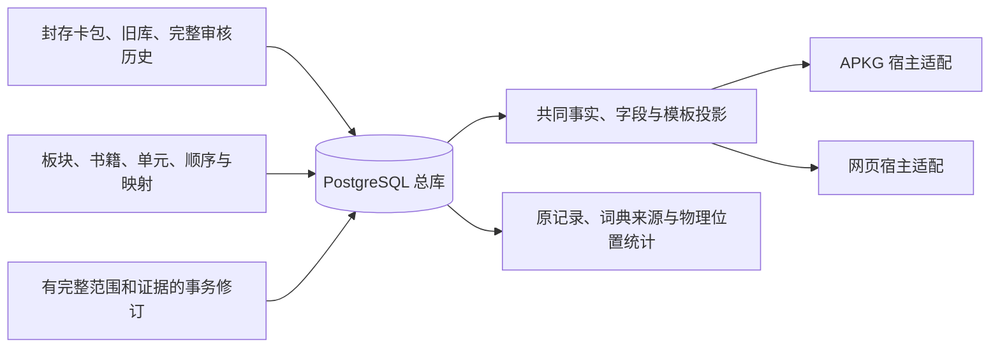

# PostgreSQL 统一学习资料库

考研英语、雅思、数学以及以后新增的板块共用一个总库。书籍只配置版本、单元、顺序和资料映射，
不按年份、书名或学科复制生成器。Anki 和网页经过同一条 `project_book` / `project_note` 投影；
词汇判义、物理位置计数与词典证据是英语内容适配，普通题目、公式和多模板卡不必有 `Word` 字段。

本分支已经完成三本现有书、旧词库和完整语义审核历史的实际迁入，并从 PostgreSQL 生成三份完整 APKG。
全库深校验和完整备份恢复已通过，24表8,118,998行完整payload独立对账一致。
三本v3及统一生成器已经接入完整卡片准备、同卡正反面复用和有界预取。
普通卡实际切换已有毫秒级结果，超长卡首次打开的性能仍在优化，不能据此宣称所有卡首次秒开。
当前三书运行时为v19，已验证范围和未完成性能见[验收记录6.19节](STUDY_CATALOG_ACCEPTANCE_20261015.md#619-v19-成员缓存公共实现正式三书与安装)
及[最新交付记录](STUDY_WEB_FACE_DELIVERY_PLAN_20261016.md)。
具体范围见[实施记录](UNIFIED_STUDY_DATABASE_PLAN.md)及[本阶段验收证据](STUDY_CATALOG_ACCEPTANCE_20261015.md)。
当前书架保留原样式并连接本地新版网页；既有 Release 没有替换，本分支没有发布新的卡包，
也没有写入用户真实 Anki 集合。



## 1. 环境与连接

在项目根目录安装锁定依赖。PostgreSQL 必须已有一个专用数据库和普通账号；`init` 初始化的是本项目 schema，
不会替你创建或重配 PostgreSQL 服务。

```sh
uv sync --frozen
export ANKI_STUDY_DSN='host=/tmp dbname=anki_study_catalog user=anki_study_catalog_owner connect_timeout=60'
uv run anki-study init
uv run anki-study status
uv run anki-study library
```

本机工作实例是 PostgreSQL 17、数据库 `anki_study_catalog`、schema `study_catalog`、普通角色
`anki_study_catalog_owner`。沿用本地服务和认证，没有把 PostgreSQL 开放到局域网。
密码只放受保护的连接环境，不放命令参数、日志、Markdown 或 Git。`--dsn-env` 可选环境变量名，
`--schema` 必须放在子命令前，例如 `anki-study --schema study_restore_check verify --deep`。
查询和导出连接默认有界等待，并尊重 DSN 中显式声明的 `connect_timeout`。

维护说明：本机 Documents 下的 iCloud 按需取回曾阻塞 `.venv`、源码缓存及大量小文件写入。
本次验收使用 `/tmp/anki-study-runtime-20261015` 的锁定依赖及 `/tmp/anki-study-source-20261015` 源码快照；
它们不是第二套业务逻辑，也不是长期安装路径。没有改动系统设置或删除原资料。
源码变化后必须明确同步快照，不能把旧快照的测试当作新代码通过。大量网页产物放在非 iCloud 的
`/Users/apple/Library/Application Support/AnkiStudyCatalog/exports/20261015/`。

## 2. 迁入已有资料

单本导入使用唯一书籍 ID 和输入摘要。以下带尖括号的值都必须先替换；它们不是当前总库的可执行修订请求。

```sh
uv run anki-study import-book --id '<new-book-id>' --title '<书名>' --edition 2028 \
  --file '<已封存的完整包.apkg>' --sha256 '<输入文件的64位SHA256>'
uv run anki-study import-history --kind legacy --file '<旧词库.sqlite3>'
uv run anki-study import-history --kind semantic --file '<完整语义审核库.sqlite3>'
```

如果有已核对的旧目录，`import-book` 可加 `--catalog '<catalog.json>'`；有与包一致的原始解包集合，
可加 `--collection '<collection.anki2或collection.anki21>'`。不能拿别的版本的集合或目录拼接输入。

成批迁移清单使用 `study-catalog-inputs.v1`：`books` 的每项含 `id/title/edition/package/sha256`，
可选 `catalog/collection`；`sqlite_sources` 的每项含 `file/kind`。本批实际命令为：

```sh
uv run anki-study migrate --manifest data/study-catalog-inputs-20261015.json \
  --report output/study-catalog-20261015/migration-v1.json \
  --backups backups/study-catalog-20261015
```

现有报告与输出不能覆盖。中断的同批迁移只续传已封印输入和已提交行，使用首次输出的 PostgreSQL 备份：

```sh
uv run anki-study migrate --manifest data/study-catalog-inputs-20261015.json \
  --report '<尚不存在的迁移报告.json>' --backups backups/study-catalog-20261015 \
  --resume-backup '<首次迁移基线.pg.jsonl.gz>'
```

完整源不重复迁入；不完整源保持 `building`，两类正式导出及公共内容修订均拒绝不完整总库。
历史表的原列、表定义、二进制值、全部行、原行顺序与行流摘要保留；当前记录另外归一化，历史不覆盖。
APKG 原字段、GUID、note/card/model/deck ID、排程、原媒体字节和文件名保留；现代包的
`collection.anki21`、兼容集合及 `meta` 也属于封存内容。

本批迁入后已安装公共展示注册表、保存完整原目录并绑定旧词卡来源。复用时可按需核对这组幂等命令：

```sh
uv run anki-study register-presentation
uv run anki-study retain-catalogs --manifest data/study-catalog-inputs-20261015.json
uv run anki-study bind-legacy
uv run anki-study verify --deep
```

## 3. 查询当前事实和统计

```sh
uv run anki-study word --word train
uv run anki-study record --book redbook2027 --card '<source_card_id>'
uv run anki-study frequency --word train
uv run anki-study frequency --word train --book redbook2027
```

`word` 返回各书的原卡身份、单元、共享组件、词典义项及 `active_records`。
字段的 `component_sha256` 是组件版本，`current_sha256` 包含当前语义正文投影；不要把旧组件摘要误当当前释义正文。
`record` 返回完整当前审核记录、`record_sha256` 和 `analysis_reference`。映射书指向底层原分析，
不会制造一份重复分析。后续修订的 `expected` 使用这些**当前底层**记录的摘要。

统计对原始物理位置取并集：同段三个目标位置计三次，另一书引用这三处不会使总库变成六次。
书内和各词典义项仍分别列出来源。中文相同不自动代表相同词典义项；展示合并不参与计数。
同段同义的多次出现合并展示，不同义项分别展示，各次 target 和证据仍保留；不额外添加出现次数徽标。
完形只计正确答案回填后的正文，忽略独立选项；阅读保留全部候选及答案状态、题干/选项命中来源。

没有归一化审核记录时，统计返回 `not_normalized` 与空值，不能解释为出现零次。
旧卡已有原始字段和统计仍保留。原输入中的 `as convenient and provocative` 结构异常继续单独标记，
本次迁库没有替它编造具体义项。

## 4. 新书与板块分类

新书可以只提供映射，无需先制作另一份旧 APKG：

```json
{
  "schema": "study-book-map.v1",
  "id": "example-vocabulary-2028",
  "title": "新词书示例",
  "edition": 2028,
  "scope": {"subject": "英语", "exam": "IELTS", "language": "en", "topics": ["词汇"]},
  "units": [{"name": "核心词::Unit 01", "words": [
    {"word": "train", "from_book": "<明确的来源书ID>"},
    {"word": "training", "from_book": "<明确的来源书ID>"}
  ]}]
}
```

```sh
uv run anki-study create-book --mapping data/my-book-map.json
uv run anki-study classify --book '<book-id>' --scope-file data/my-book-scope.json \
  --backups backups/study-catalog-classification
uv run anki-study library --subject 数学
uv run anki-study library --exam IELTS
```

分类文件直接是 scope 对象：`subject` 必填，`exam/language/topics/kind` 可选。
分类只改变元数据，不选择另一个生成器，也不重写旧导出文件。
同映射重复执行不会新增卡；不同映射不能静默覆盖同一个书 ID。存在同名多个来源时必须指定
`from_book` 和必要的 `from_card`，不猜词形、大小写或词典版本；同单元的重复条目需要不同 `key`。
新书复用公共字段、模板和媒体对象，但创建自己的合法 Anki 身份并从未学习状态开始，
不会复制来源书的个人复习进度。

数学等无 `Word` 字段的条目使用 `items` 和明确来源：

```json
{
  "schema": "study-book-map.v1", "id": "example-math-review", "title": "数学复习示例", "edition": 2028,
  "scope": {"subject": "数学", "exam": "考研", "topics": ["极限"], "kind": "题目"},
  "units": [{"name": "高数::极限", "items": [
    {"from_book": "<数学来源书ID>", "from_note": 1234567890123}
  ]}]
}
```

`from_note` 是来源原 note ID；`from_card` 可改用明确的公共来源 ID。
一条 note 有两张正向/反向模板卡时，网页目录与 APKG 都导出两张实际卡，不能按 note 数缩成一张。
公式保留原 TeX；Anki 使用其原生数学宿主，网页使用同一内容配合离线 MathJax。
本批已经验证无 Word 的一条数学 note、两张模板卡；这不是所有数学模板或手机平台的验收。

## 5. 雅思、书籍、文章等来源身份

旧 `kaoyan:YYYY-NN` 及既有语义封印保持不变。新增语料使用 `study:<namespace>:<source-key>`，
句子 ID 必须属于该来源前缀，并在 `source_provenance.study_source` 中提供显式证据：

```json
{
  "study_source": {
    "schema": "study-source.v1",
    "id": "study:ielts:example-source",
    "namespace": "ielts",
    "kind": "exam",
    "label": "<真实资料名称>",
    "locator": "<试卷/篇章/段落等精确位置>",
    "year": null
  }
}
```

来源 `kind` 为 `exam/book/article/lesson/other`；年份必须明确给整数或 `null`。
`null` 在界面显示“未注明年份”，不从书名或显示标签猜年份，也不向用户显示内部的 0 哨兵值。
此证据结构验证身份和封印绑定，不替代对资料真实性、译文或词义的人工核对。
书籍分类里的自由 `scope.kind` 与这里的来源类型枚举用途不同。

## 6. 公共修订的一致规则

正式写入先保存 PostgreSQL 一致性备份，再在共同写锁与事务内核对当前完整范围。
有任一旧摘要过期、缺少受影响词/书、混入无关记录、目标范围不符、证据或展示无法保留，整事务拒绝；
不能只把其中一本写成功。备份文件会作为独立回退证据保留。

`expected` 格式为 `{"<来源书ID>/<原source_card_id>": "<当前record_sha256>"}`。
范围是此次操作影响的全部底层分析，可能跨多本书、多个词；映射书通过 `analysis_reference` 复用，
不能把它伪造成重复的底层记录。`word` 和 `record` 提供当前身份；源句修订还必须核对同物理来源的其他词。
范围选择的实现见 [content 修订](../anki_pipeline/study_catalog_content.py)与
[转归修订](../anki_pipeline/study_catalog_ownership.py)，接口不会自动接受一个随意删减的请求范围。

| 操作 | 使用的命令 | 不能代替的工作 |
|---|---|---|
| 公共词典释义与详细证据 | `amend-sense` | 逐个复核受影响用例和共同义项证书 |
| 已有目标的义项归属 | `amend-decision` | 目标词实际语法、上下文和词典依据 |
| 原句、译文、范围及双语 chunk | `amend-sentence` | 完整 source、每个 token 和补全展示的重新核验 |
| 错归词条的原位置转移 | `transfer-occurrence` | 已有合法目标词条和对应词典义项 |
| 普通字段、已登记模板/CSS/JS | `edit-field` | 以上语义事实修订 |

所有请求示例都是安全占位结构；`<...>` 必须替换，完整对象必须从当前 `record` 复制并审核，不能原样提交。
实际主库本批没有写入这些示例的语义修订。相关写入、回滚及交叉导出验证使用隔离 PostgreSQL schema。

### 6.1 修订词典义项

```sh
uv run anki-study amend-sense --request-file data/reviewed-sense-request.json \
  --backups backups/study-catalog-edits
```

请求文件：

```json
{
  "sense_id": "<word报告中的全局dictionary_senses ID>",
  "expected_sense": {"pos": "<精确旧词性>", "text": "<精确旧释义>"},
  "new_sense": {"pos": "<核定新词性>", "text": "<核定新释义>"},
  "reason": "<修改理由与上下文判断>",
  "expected": {"<来源书ID>/<source_card_id>": "<当前record_sha256>"},
  "evidence": {
    "dictionary": "<原词典身份>", "entry": "<原词头>",
    "entry_html": "<完整核对条目HTML>", "locator": "<该词典具体位置>",
    "quoted_definition": "<条目内实际存在的详细释义>",
    "reviewed_pos": "<与new_sense一致>", "reviewed_text": "<与new_sense一致>",
    "usage_reviews": {"<来源书ID>/<source_card_id>": {
      "<每个受影响occurrence_id>": "<核对详细词典解释后，本处仍适用的依据>"
    }}
  }
}
```

不能借修订静默更换词典身份或词头。已有共同义项证书受影响时，还需显式提供对应 `group_reviews`。
优先使用已核实的双语条目；只有英释、确需补译时，明确 `translation_kind=reviewed-translation`，
并提交审定后的中译证据。操作校验所给材料的绑定，不自动检索、猜义或翻译。
完整原条目、原审核与修订证据继续保留；物理次数不因释义文字改变而增加。

### 6.2 修订原句、译文或 chunk

```sh
uv run anki-study amend-sentence --request-file data/reviewed-sentence-request.json \
  --backups backups/study-catalog-edits
```

顶层结构：

```json
{
  "paper_id": "<精确来源ID>", "physical_source": ["<从record完整复制的物理来源键>"],
  "expected_source": {
    "english": "<精确旧英文>", "translation": "<精确旧译文>",
    "alignment": "<替换成完整旧alignment对象>",
    "source_provenance": "<替换成完整旧来源证据对象>"
  },
  "new_source": {
    "english": "<核定新英文>", "translation": "<核定新译文>",
    "alignment": "<替换成完整核定alignment对象>",
    "source_provenance": "<替换成完整核定来源证据对象>"
  },
  "occurrence_reviews": {"<来源书ID>/<source_card_id>": {
    "<旧occurrence_id>": {
      "expected": "<替换成下表5项完整旧对象>",
      "new": "<替换成下表5项完整核定对象>"
    }
  }},
  "expected": {"<来源书ID>/<source_card_id>": "<当前record_sha256>"},
  "reason": "<原卷、译文与分块核对依据>"
}
```

每个 token 的 `expected/new` 都必须完整包含 `target_range`、`translation_ranges`、
`alignment_evidence`、`reason`、`display` 五项，保持其真实 JSON 类型。范围是 Unicode codepoint 半开区间，
不能使用 UTF-8 字节偏移或只补一个更改后的起点。对齐对象还需绑定新英文/译文摘要和全部已核定细块。
只改 chunk 时也使用本接口，英文与译文不变，提供完整新对齐。

补全题干、阅读选项或完形来源已有 `display` 时，必须保留并重新核验整套来源/翻译/chunk/display 证据，
不接受把它删成 `null`，也不把原细块替换成整句自动对齐。一个物理来源有多种保存变体时，用
`expected_source={"variants":{"<旧4项source对象的规范SHA256>":{...}}}` 与相同键集的 `new_source`
完整列出各变体，不能只选容易匹配的一份。
本操作保持目标词面与词条归属；范围可以随上下文移动，不能夹带目标拼写或归属变更。
修订后的来源链与完整旧记录保留，并防止反复把整个先前记录递归嵌入导致历史指数增长。

原生正文使用压缩类名时，首次请求可增加 `aliases_by_book`，例如
`{"redbook2027":{"ec":"example-card","et":"example-text","ez":"example-translation","sj":"sentence-jump","tt":"translate-tag","tw":"target-word","cc":"card-chunk"}}`。
它只接受本次 CAS 范围内来源书的、已核实且完整的映射；映射书继承来源书配置。
成功后配置随投影保留，后续可省略；未知、遗漏或与已有配置冲突均整批回滚，不能静默保留旧正文。

### 6.3 转归错误词条

```sh
uv run anki-study transfer-occurrence --request-file data/reviewed-transfer-request.json \
  --backups backups/study-catalog-edits
```

```json
{
  "source_word": "<精确原词条>", "target_word": "<精确正确词条>",
  "physical_id": "<待转归的occurrence_id>", "sense_id": "<目标全局词典义项ID>",
  "reason": "<结合实际语法、上下文和词典解释的判断>",
  "evidence": {"dictionary": "<目标词典>", "definition": "<详细解释>", "locator": "<原条目位置>"},
  "expected": {
    "<来源书ID>/<原词条source_card_id>": "<当前原记录SHA>",
    "<同书ID>/<目标词条source_card_id>": "<当前目标记录SHA>"
  }
}
```

示意只列一对记录，实际必须覆盖所有受影响原书的源/目标对。每本书以及受影响映射书必须已有唯一合法目标。
可选 `aliases_by_book` 与原句修订使用相同的已核实类名映射，不能凭猜测屏蔽无法处理的内容。

原位置从错误词条的当前展示和计数退出，进入正确词条；原句、译文、目标范围、双语 chunk、
完整原审核、原归属和修订理由在目标句子内保留。物理位置没有被创造或删除，源/目标次数同步调整。
原始跳转证据仍按各成员保存，不把多个原句引用伪造为一个联合范围的新封印。

### 6.4 其他修订入口

```sh
uv run anki-study amend-decision --word '<精确词条>' --physical-id '<原位置ID>' \
  --sense-id '<全局义项ID>' --reason '<完整依据>' \
  --expected-file data/complete-record-scope.json --backups backups/study-catalog-edits
uv run anki-study edit-field --component '<组件ID>' \
  --expected-file data/exact-before.txt --value-file data/reviewed-after.txt \
  --reason '<修订依据>' --backups backups/study-catalog-edits
```

`edit-field` 校验精确旧文本。词头、Meta/音频绑定以及词条的 Definition/Examples 不开放任意 HTML 覆盖，
应走正式映射或上述事实修订。注册模板、CSS、JS 与普通通用字段的修订仍保留原组件和完整事件。
同一秒连续修订及 A→B→A 回退也推进 note/model 版本，避免 Anki 忽略“内容回到原稿”的更新；
运行时资源依赖、语义正文与新映射书共同核对。语义编译先取未应用运行时别名的原投影，最终导出只应用一次当前别名。

## 7. 同一逻辑导出两种宿主

```sh
uv run anki-study export --book redbook2027 --format apkg --output '<新输出路径.apkg>'
uv run anki-study export --book redbook2027 --format web --output '<新网页目录>'
```

输出均读取同一当前事实、字段与模板版本，网页不另做判义或计数。原书身份保留；新映射书分配独立的
合法毫秒创建 ID。修订推进版本而不重建旧 GUID，不把公共资料库写成用户的学习进度库。
未做内容/运行时修订的基线可恢复原包每一个 ZIP 成员的未压缩字节；压缩封装本身和包文件 SHA 可以不同。
修订后的包必须保留新的正文、审核和单调版本，不能为追求原包字节一致而丢掉修订。

网页只做宿主适配：只展示一面，最多保留当前卡正反两份文档；Anki 声音标签转浏览器音频，
源 CSS 和无字段变量脚本按原字节外提。统一factory在媒体写完后生成可逆的整面交付资源，
正面期间准备当前背面，词源在最终宽度下完成原交互及布局后才整面切换；反复翻面保留已经就绪的DOM，
换卡才清理旧面。每次复用仍核对实际文档身份、字体、尺寸及词源布局，切面暂停旧音频，不自动播放。
共同宿主另保留最多4卡、16MiB计费的已验证数据缓存，并预测下一卡或用户指向的卡；只允许1个后台卡任务，
原wrapper及解压后的交付资源各在2MiB流式上限前停止预取，不在后台解析超大卡。前台选择仍可读取完整内容。
原字段、审核共享引用、原始媒体及物理计数仍由共同资料投影提供，展示优化不另设每书内容逻辑。
离线数学使用固定 MathJax 3.2.2 的 25 个资源；安装包另含其 SOURCE 清单与许可。
目录中有 `COMPLETE.json` 才表示生成完成；该标记不是手机或实际交互通过的证明。
原媒体数与网页额外宿主资源数分别报告。已存在输出不覆盖；分类或内容再更新不会自动改写旧导出快照。

## 8. 备份、恢复和验证

```sh
uv run anki-study backup --directory backups/study-catalog
uv run anki-study restore --file '<完整备份.pg.jsonl.gz>' --new-schema study_restore_check
uv run anki-study --schema study_restore_check verify --deep
```

备份明确标记 `engine=postgresql` 与 `study-catalog-postgresql-backup.v1`，含全部表、字段类型、二进制内容、
每表行数和原行流摘要。恢复只写新 schema，不能覆盖当前主库；格式、摘要或行数不符则事务回滚。
完整恢复还必须独立与备份逐表对账，不能只用“恢复命令退出成功”或空库基线代表完成：

```sh
uv run python - <<'PY'
import json, os
from pathlib import Path
from anki_pipeline.study_catalog import Target
from anki_pipeline.study_catalog_recovery import verify_restore
report = verify_restore(Path('<完整备份.pg.jsonl.gz>'), Target(os.environ['ANKI_STUDY_DSN'], 'study_restore_check'))
print(json.dumps(report, ensure_ascii=False, indent=2))
PY
```

独立对账校验备份原始行流，再以有界内存的逐表行指纹比较恢复结果，保留重复行数量，
并检查序列未来插入的安全性和 schema 范围；不依赖数据库物理扫描顺序。
备份 v1 不包含历史 sequence 高水位，不能宣称恢复了原 sequence 的全部历史状态。
`verify --deep` 另检查解压对象摘要、
历史行流和物理位置一致性。首次迁移前的空库备份仅是回退基线，不是迁入全部内容后的恢复证明。

开发测试必须明确选择实际测试数据库；测试自行创建并清理随机隔离 schema，不使用真实 Anki 档案：

```sh
export ANKI_STUDY_TEST_DSN='host=/tmp dbname=anki_study_catalog user=anki_study_catalog_owner connect_timeout=60'
uv run python -m unittest discover -s tests -p 'test_study_catalog*.py'
uv run python -m unittest tests.test_study_source_identity
```

未设置测试 DSN 时跳过的 PostgreSQL 用例不构成数据库验收。原生 Anki 字段检查必须区分原文相等与客户端 NFC 规范化；
完整原包成员字节、媒体字节、原生模板渲染、Safari 实际交互及手机验收分开记载。
最新实际范围、输入与产物摘要、仍未闭环的项目见[验收记录](STUDY_CATALOG_ACCEPTANCE_20261015.md)。
