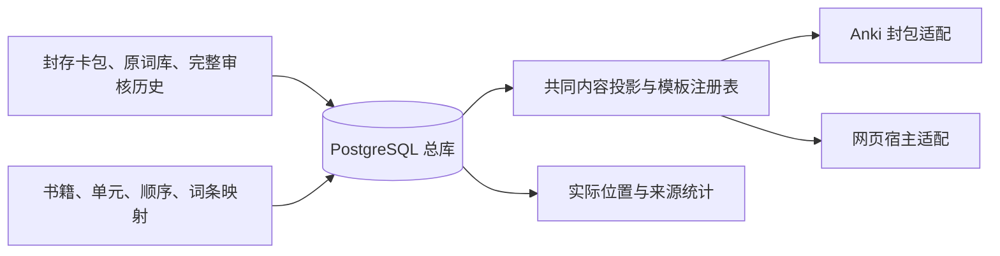

# PostgreSQL 统一学习资料库

所有书籍通过同一套 `anki-study` 命令读取、映射和生成。书名和年份不决定代码分支。
总库不限定考研英语：学科、考试、语言、主题作为资料分类，数学、雅思等使用同一总库。
普通 Anki 字段和多模板卡也使用共同投影，词汇查询/义项统计是英语板块的专用事实适配。
PostgreSQL 保存公共资料与书籍映射；SQLite 只保留为历史只读输入和 Anki 封包格式。
当前实施范围、Git 节点和验收状态见[实施记录](UNIFIED_STUDY_DATABASE_PLAN.md)。



## 安装与连接

在项目根目录运行 `uv sync --frozen`。PostgreSQL 17 必须先存在一个专用数据库和普通账号。
本机工作实例使用 `anki_study_catalog` 数据库、`anki_study_catalog_owner` 普通角色，
只监听原有本地地址；没有改变其他数据库或用户的 Anki 集合。

```sh
export ANKI_STUDY_DSN='host=/tmp dbname=anki_study_catalog user=anki_study_catalog_owner'
uv run anki-study init
uv run anki-study status
```

连接信息从环境变量读取；不要在命令参数、报告或 Git 中放密码。
`--schema` 可以选择明确的独立 schema；测试使用随机隔离 schema，恢复必须使用新 schema。

## 迁入现有资料

迁移清单格式为 `study-catalog-inputs.v1`，保存在本地忽略目录。每本书指定
`id`、`title`、`edition`、`package`、`sha256`；已有目录还指定 `catalog`，
已有精确解包副本可以指定 `collection`。`sqlite_sources` 列出 `file` 和 `kind`（`legacy` / `semantic`）。

```sh
uv run anki-study migrate --manifest data/study-catalog-inputs-20261015.json \
  --report output/study-catalog-20261015/migration-v1.json \
  --backups backups/study-catalog-20261015
```

导入完整保留原字段、GUID、note/card/model/deck ID、排程记录、媒体原字节与文件名，
包括现代 APKG 的 `collection.anki21`、兼容占位集合及 `meta`。
每张历史表保留原列、原表定义、全部原始行、二进制字段、原顺序及行流摘要；
当前审核记录另外归一化为词典义项、双语句子、实际目标位置、chunk 和判定，不覆盖历史。

大表按事务批次续传。中断后源状态保持 `building`；两类正式导出均拒绝不完整总库。
使用同一份输入及首次输出的备份路径续传：

```sh
uv run anki-study migrate --manifest data/study-catalog-inputs-20261015.json \
  --report output/study-catalog-20261015/migration-v1.json \
  --backups backups/study-catalog-20261015 \
  --resume-backup backups/study-catalog-20261015/首次迁移输出的文件.pg.jsonl.gz
```

输入摘要必须相同。完整表不重复迁入；不完整表从已经提交的行序号继续。
结束后安装共同模板与保留完整目录、绑定旧词卡的精确来源：

```sh
uv run anki-study register-presentation
uv run anki-study retain-catalogs --manifest data/study-catalog-inputs-20261015.json
uv run anki-study bind-legacy
uv run anki-study verify --deep
```

## 查词与统计

```sh
uv run anki-study word --word train
uv run anki-study frequency --word train
uv run anki-study frequency --word train --book redbook2027
```

查词输出每本书的目录映射、原卡身份、共享字段组件及词典原义项。
统计按原始物理位置去重：同一段三次出现仍计三次；另一书引用相同三个位置，总库不累加成六次。
各书及各词典义项另列来源，不按中文相同就猜成同一义项。正文展示合并不参与计数。
没有归一化审核记录时返回 `not_normalized` 和空值，不冒充“出现零次”；
其原卡已有统计与完整原始数据仍保留。这一点适用于未做该轮义项审核的旧书资料。

## 新书只配置映射

不需要先制作另一份旧 APKG。下面的 JSON 使用已有公共资料：

```json
{
  "schema": "study-book-map.v1",
  "id": "example-2028",
  "title": "新书示例 2028",
  "edition": 2028,
  "units": [
    {
      "name": "核心词::Unit 01",
      "words": [
        {"word": "train", "from_book": "redbook2027"},
        {"word": "training", "from_book": "redbook2027"}
      ]
    }
  ]
}
```

```sh
uv run anki-study create-book --mapping data/my-book-map.json
```

大小写、词形及词典版本保留。存在多个同拼写来源时，用 `from_book` 和必要的 `from_card`
明确选择资料组合；不自动猜测。单位内重复词条需要明确的不同 `key`。
相同映射重复执行不新增卡；不同映射不能静默替换已经存在的书。
新增书复用共享字段、模板组件和媒体对象，仅新增书籍映射、目录元数据和自己的 Anki 身份。
新增卡从未学习状态开始，不把其他书的复习记录转移给它。

数学题等无 `Word` 字段的条目，用 `items` 加明确的 `from_book` 和 `from_note`
（原 note ID）或 `from_card`（公共来源 ID）映射，不必伪装成单词：

```json
{
  "schema": "study-book-map.v1", "id": "math-review-2028",
  "title": "数学复习", "edition": 2028,
  "scope": {"subject": "数学", "exam": "考研", "topics": ["极限"], "kind": "题目"},
  "units": [{"name": "高数::极限", "items": [{"from_book": "math-source", "from_note": 1234567890123}]}]
}
```

`scope` 不控制生成分支。雅思可以标记 `subject=英语, exam=IELTS`，同一个英语条目可被不同考试资料引用。
已有书籍可用 `classify --book ID --scope-file data/scope.json --backups backups/catalog` 分类，
用 `library --subject 数学` 或 `library --exam IELTS` 查询。每个真实 native card 的模板序号均进入网页目录；
不会把一条 note 的多张正反向卡缩成一张。公式原文和模板完整保存，网页公式排版需经浏览器验收。

## 共同修订与两种导出

`word` 返回共享组件 ID。字段版本相同时一次修订会进入所有引用它的书，
不同词典或不同历史版本不会被暗中强并。共享模板/CSS/JS 同样通过组件注册表修订。
编辑前保存一致性备份，校验精确旧文本，提交修订理由；旧内容和事件继续保留。

```sh
uv run anki-study edit-field --component 组件ID \
  --expected-file data/exact-before.txt --value-file data/edited-after.txt \
  --reason '本次修订的具体依据' --backups backups/study-catalog-edits
```

词头、目录和音频绑定需要正式映射修订，不能当作普通字符串覆盖。
义项归属及实际位置是独立的审核事实，不通过随意修改 HTML 中的数字重算。

```sh
uv run anki-study export --book redbook2027 --format apkg --output output/catalog-2027.apkg
uv run anki-study export --book redbook2027 --format web --output output/catalog-2027-web
```

两种格式经过同一个 `project_book` / `project_note`，读取同一字段与模板版本；
网页不另判义或计数。未修订的数据可恢复封存包的每个 ZIP 成员原字节。
网页只进行宿主适配：一次运行一面的文档、把 Anki 声音标签转换为浏览器音频，
把重复 CSS 和不含字段变量的脚本作为共享资源交付。
网页目录出现 `COMPLETE.json` 才表示构建完成。现有输出不覆盖，当前书架和已发行附件不自动切换。

## 备份、恢复与验收

```sh
uv run anki-study backup --directory backups/study-catalog
uv run anki-study restore --file backups/study-catalog/具体文件.pg.jsonl.gz --new-schema study_restore_check
uv run anki-study --schema study_restore_check verify --deep
```

这是明确标识 PostgreSQL 的一致快照，包含全部表、精确字段类型、二进制内容、每表行数和行流摘要。
恢复只写新 schema；校验失败则整笔回滚。不能把旧 SQLite 文件备份冒充 PostgreSQL 恢复。
深校验检查所有对象解压后的摘要、完整历史行流、实际位置数量；
原生导入、网页交互及手机入口分别记录实际验证范围。测试或 ZIP 生成不代表客户端全部验收。
