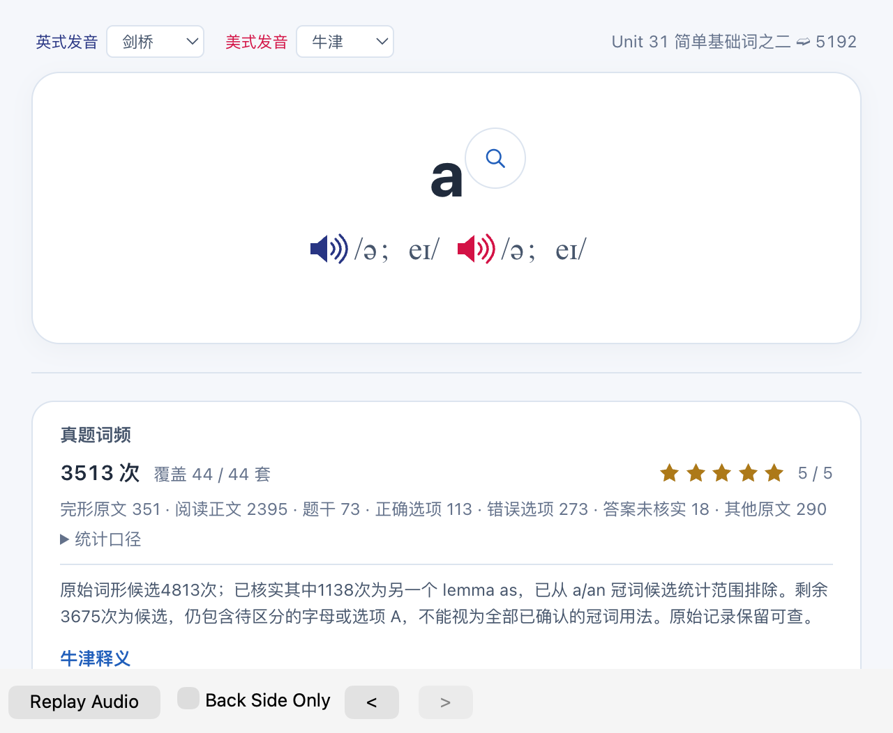

# 官方 Anki 完整背面的实际窗口记录

此前后台成功不能替代真实窗口。一次 Python SDK Cocoa 测试在进入编辑器时以 SIGSEGV 崩溃，未走到 Preview。原始 IPS 中，故障线程 voucher 明确指向 `SkyComputerUseService`。同一 `libqcocoa` UUID 的故障 offset 与先前相同，均为 **554036 / 0x87434**，随后是 AppKit／NSAccessibility 属性读取；当前测试进程没有 bundleInfo，先前官方 Anki 为 `net.ankiweb.anki`。[voucher](AX-VOUCHERS.json)、[身份](PROCESS-IDENTITY.json)、[故障位置比较](PRIOR-AX-COMPARISON.json)分别保留。

本机 Computer History 当时正在运行，当前 app blocklist 已有 `net.ankiweb.anki`。本轮只读核对状态／设置，没有暂停、删除记录或修改规则。SDK Python 测试不能依赖该 Anki 身份排除；未调用 CUA 不等于没有后台 AX 请求。[官方论坛第一手复现](https://forums.ankiweb.net/t/macos-accessibility-scan-can-crash-browse-when-a-row-is-selected/70882)也记录选中 Browse 行后，后台扫描进入 Qt 同一路径。此前字段查询慢仍有独立证据，不将每次卡死均归因于 AX。

## 唯一一次官方应用测试

安装的 `/Applications/Anki.app/Contents/MacOS/Anki` 通过 `-b` 打开新的自有完整私有副本。实际 runtime 身份为 `net.ankiweb.anki`，共 6,682 张笔记，进入原始约 9 MB 字段的 `a`。没有读取正式个人集合、修改安装或连接 PostgreSQL。

- 原生 Browser 加载及字段检查完成，正面外层 ready 在启动累计 **9.160 秒**。
- 原 Preview `_on_next()` 后 **4.657 秒**首次完整背面外层 ready；同 id、generation 1→2、answer/ready 均为 true。
- 3513 个例句节点、15 个义项、516 个 details 已建立；等待 Qt 绘制后抓取实际 Previewer 窗口，累计 14.161 秒保存 1280×1052 图片。
- 截图前 Qt tick 最大间隔约 1.464 秒。这不是秒开或全部卡片／手机验收。

## 关闭与证据限制

14.263 秒调用原生 `mw.close()`；关闭阶段另有约 **17.126 秒** tick 间隔，不能掩盖或计作翻面时间。父监控清理时发生 `killpg PermissionError`，未保存正常退出码／准确退出时间，不声称干净 exit 0。[原监控错误](MONITOR-ERROR.json)保留。之后两次独立核对确认该 PID、进程组及独特私有 `-b` 路径均无成员；本次时间段无新 Anki IPS 文件名。没有重开窗口。

源库全 SHA、原 a 字段、源媒体目录和安装 pins 未变。原生 save／close 对自有副本发生 HTML 规范化，单独记录，不声称该副本字段始终逐字不变。此前索引优化的逐格相同证明属于进入编辑器之前。

[摘要](SUMMARY.json)、[快照](TERMINAL.json)、[数据与进程后验](POSTFLIGHT.json)、[完整范围](REPORT.md)和[复制文件 pins](evidence.json)分别保留。该次验证是旧 v4 资源加列表修正／索引统计副本；后续分组载体、缓存和新完整包不能复用此图宣称已验收。
