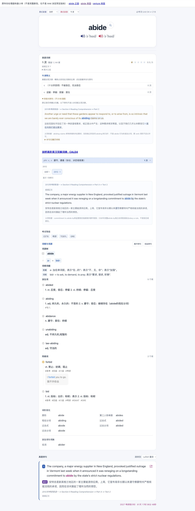

# 原生年份筛选处理器恢复

完整 v3 候选的原模板、CSS、Meta 与实际 APKG 媒体在浏览器运行检查中暴露了一个具体缺失：`venture` 的义项和待核对例句均能展开，但点击 `2021` 时仍选中 `all`，随后报 `Compiled card invalid: authored filter status`，原生宿主显示“完整卡片无法校验”。同一词卡的现行原网页版能正常筛选。

原生 projector 只提取了 decoder、residual 和 codec／Slim loader，漏掉中间的原作者 `sense-frequency` IIFE。该原处理器负责切换 `aria-pressed`、筛选原行并写中间状态“显示 N 处原文”；共同 binder 验证这一阶段后完成同义合并，最终显示“N 条原文”。缺少原处理器时，后续 Slim 读取的是旧选中项和旧状态，所以校验失败。

修复恢复已由完整 prepared module SHA 认证的 **2,011 字节原 IIFE**，SHA 为 `f378c04e7e9d7aebe1f0ed3fa31ac986e569bf00d5b44dcf936528c72bfe1560`。新 loader 按 decoder、residual、原作者处理器、codec／Slim 排列，四段 `source_ranges` 可精确拼回原字节。两种原 module cohort 都得到新 loader SHA `d17ea6bef41ff58a09b9b76f8ab9113bc1ad480eeb9d209d1dfc49ff4298a74e`。未放宽 binder 的中间状态校验，也没有新增另一套筛选实现。

回归先在漏带处理器的版本失败，修复后 Python 3.13 相关 43 项通过。新增检查覆盖两个 module cohort、真实提取 loader、非空面板、作者阶段与最终合并结果、同文档跨 cohort 重挂载只绑定一次；独立复核未发现 P1/P2，并独立运行新增两项通过。Python 3.11 因本机依赖环境未完成，不记为通过。

真实浏览器复验使用完整 2027 候选的 `abide`、`venture` 原内容，复用正常 projector 产生的新 loader 和正常 `bind_native_delivery`，只在自有小样替换 packet／transport 引用。剥去新 Meta 末尾后十个源字段精确一致；entry、HTML、profile、policy、styles、local_media 与 bootstrap 均保持。新 loader 移除原作者片段及连接换行后，逐字恢复旧完整候选的 loader。

| 操作 | 小样结果 | 总词频 |
| --- | --- | --- |
| venture → 2021 | 选中 2021，完整显示 1 条 | 4 次 |
| venture → 2004 | 选中 2004，完整显示 2 条 | 4 次 |
| venture → 全部 | 完整显示 4 条 | 4 次 |
| abide → 展开两处 → 2012 | 待核对句和计频句都完整，选中 2012 | 1 次 |

上述每个小样状态都保持 `data-study-native-state="ready"`；修复前后 DOM、构造来源和逐项 SHA 见 [evidence.json](evidence.json)。`owned-browser-pilot-operation.py` 是一次只读源包、构造私有运行小样的审计副本，不是第二个正常打包入口，没有访问 PostgreSQL 或 Anki 用户集合。

**这是原生模板在浏览器中的运行小样，尚未生成包含此修复的两本完整新包，不能替代 Anki“浏览→预览”、手机或首翻速度验收。** 旧完整 v3 的归档与默认导入证据仍只支持原范围；本次发现的年份缺失意味着它不能作为已完成的原生修复包。后续须将此正常 projector 修复带入完整导出，重新绑定版本和最终归档，再做客户端检查。已发行附件及原书架入口没有被此小样替换。
